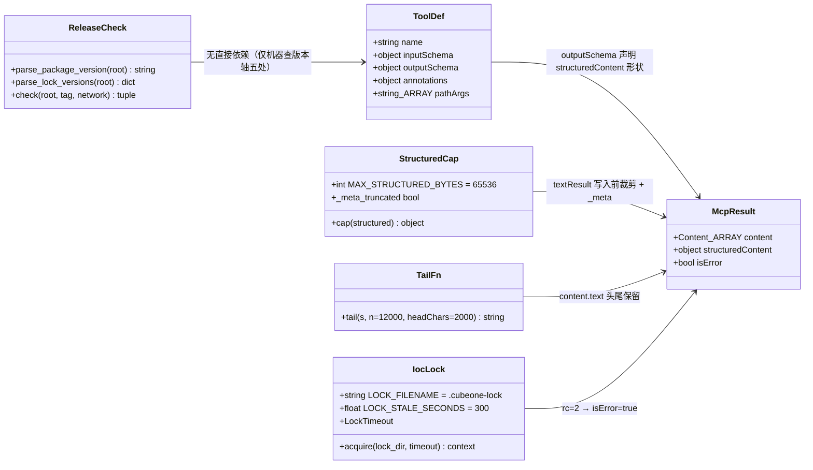
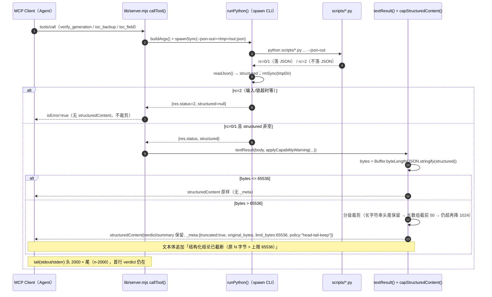
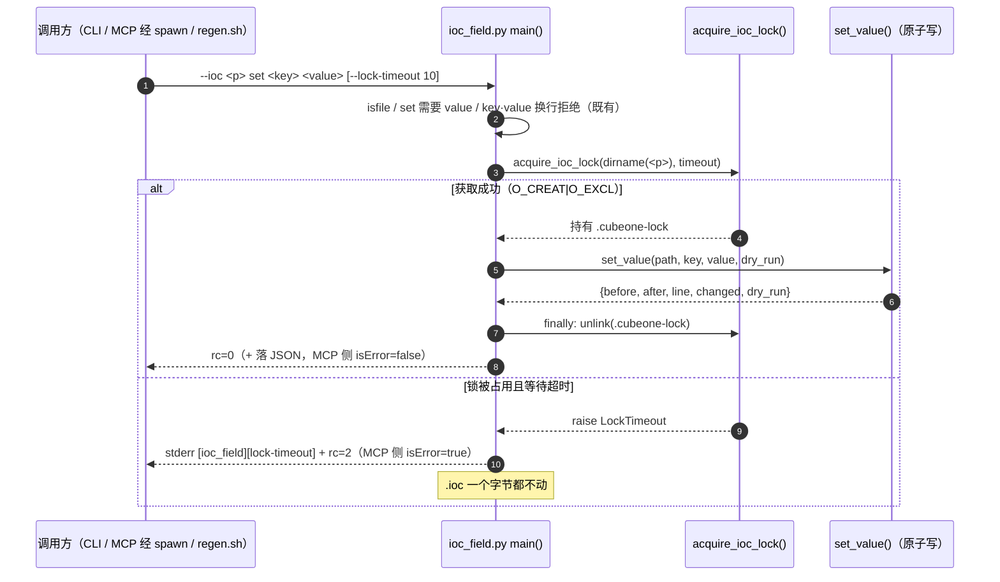

# cubeone-mcp 0.7.4 → 0.8.0 增量实现设计与任务分解（2026-11-04）

> **定位**：标准 SOP 第 2 阶段产出，把 `docs/reports/2026-11-04-v074-v080-incremental-prd.md`（A–F 六组、
> 版本策略、发布性质、Q1–Q5）收敛成**逐文件、逐函数、逐 commit** 的可执行编排，供工程师直接执行、两版均直接发版（D35 九步）。
> **基线（实测）**：HEAD `8fc07e3`；`git status --short` 仅一条未跟踪的增量 PRD（本轮不改它）；`v0.7.3` 已四证齐全。
> **依据**：PRD 全文；`docs/README.md §2.1`（B-2 / lost-update 原始登记）；`docs/DECISIONS.md` D33 / D35（九步 + §35.6）；
> `docs/releases/2026-11-04-v0.7.3.md`（验证等级 :217–237、已知限制 :239–256）；`docs/releases/README.md`（台账 :44）。
> **本文不修改任何实现文件**，只新增本文档。

---

## 0. 用户裁决与 Q1–Q5 的落实结论（不再开放讨论）

| 项 | 落实结论 |
|---|---|
| 版本策略 | `0.7.4`（patch）→ `0.8.0`（minor），两版连续、均走 D35 九步直接发版；**每版 step3 仍须用户明确放行后才打 tag**。 |
| 硬件项 | T2.2 / T2.4 / T2.5 / T2.6 / T3.3 **跳过，如实保留挂起**；不新增硬件依赖。 |
| 核验器加固 | **不做** W0-4 防伪造、W0-2 工程根内容校验（用户未选第三档）。 |
| F-1 契约 | 7 个 `CHECK_*` / `CHECK_ORDER` / `schema platform32.verify_generation/2` **恒定，不新增第 8 个 check id**。 |
| 已发布正文 | `docs/releases/2026-11-04-v0.7.3.md` **一字不改**；包体积双口径只在 0.7.4 正文与台账澄清（A①）。 |
| **Q1 CRLF** | **方案 2 为硬纪律**（发版证据只认 CI 的 LF pack；本机 `npm pack` 不作证据）；方案 1（强制重检出）为**可选本地自检、不产生 commit**。详见 §5（含「`git status` 干净 ≠ 工作区逐字节等于 index」陷阱与自检命令）。 |
| **Q2 版本轴** | **统一为「五处」**：`package.json.version` + `package-lock.json` 根 `version` + `package-lock.json` `packages[""].version` + `SKILL.md` frontmatter + README 两处（同值视为一处发布轴）。`check_release.py` **判据①扩到 lock 根两处**，落在 **D1 的 D 组**。评估结论见 §3.5。 |
| **Q3 文件锁** | 沿用 `{0,1,2}`，**不新增破坏性退出码**；锁获取超时/失败归 `2`（环境/输入错误）。Windows 无 `flock` ⇒ 用 **锁文件 `O_CREAT|O_EXCL` + 超时回收**（跨平台同一套代码，不依赖 `fcntl`/`msvcrt`）；锁文件 `.cubeone-lock`；`--lock-timeout` 默认 `10.0` 秒；单写者顺序流程**零回归**；补两进程并发负样本。详见 §3.4。 |
| **Q4 体积上限** | `MAX_STRUCTURED_BYTES = 65536`（64 KiB，`JSON.stringify` 后的 UTF-8 字节数）；**头尾保留 + 字段级裁剪**，告警字段 `structuredContent._meta.{truncated,original_bytes,limit_bytes,policy}`；`tail()` 改为**头 2000 + 尾（预算 − 2000）**，优先保证首行 `verdict` 可见。详见 §3.2 / §3.3。 |
| **Q5 outputSchema** | 三工具各声明 `outputSchema`，字段与既有 `structuredContent` 一致，**新增可选字段**、**不改 tool 名 / required / enum / additionalProperties 语义**；旧客户端忽略不报错。草案见 §3.1。 |

---

# Part A · 系统设计

## 1. 实现方案与框架选型

**沿用现栈，无新增依赖包**：Python 3.11+ 纯标准库（`json` / `os` / `time` / `sys` / `subprocess` / `pathlib` / `hashlib`）、
Node.js ESM（`@modelcontextprotocol/sdk@1.32.2` 已在库）、Bash、GitHub Actions YAML。
`package.json` 的 `dependencies` **零改动**；`scripts/` 仍纯标准库（锁用 `os.open(O_CREAT|O_EXCL)`，不引入第三方）。

**两批的架构落点**：
- **D1 / 0.7.4（收尾，不改 MCP 契约）**：只在文档口径、`tools/*` 编码、`check_release.py` 判据① 上动刀，**不碰 `lib/server.mjs` 的工具契约、不碰 `verify_generation.py` 判据**。
- **D2 / 0.8.0（契约增强，minor）**：`lib/server.mjs` 的**输出侧**（`outputSchema` / `structuredContent` 上限 / `tail()`）+ `scripts/ioc_*.py` 的**并发写侧**（文件锁）。两处都**不改输入契约**（tool 名 / required / enum / `additionalProperties` / 7 项判据 / schema `/2`）。

**核心难点与对策**：
- 「`outputSchema` 要真实反映 payload，又不能让 schema 变成第二份判据真源」⇒ 三份 schema **按现有 payload 反推**、`checks[].id` 的 `enum` 只做**形状声明**（列 7 个 id），运行时判定仍由 `verify_documents()` 唯一负责；schema 与 payload 的漂移用**节点测试**锁住。
- 「`structuredContent` 上限不能截掉结论」⇒ 裁剪**先保元信息与 `verdict`**，只裁长字符串/超长数组，并加机读 `_meta.truncated`。
- 「锁要跨平台、又不能给单写者制造延迟」⇒ `O_CREAT|O_EXCL` + 10s 超时 + 陈旧回收；正常路径 <1ms，零回归。
- 「判据①扩 lock 不能误伤历史 tag / 现有 CI」⇒ 判据①只比**最新 tag**，且 `check_release.py` **不挂 CI**；扩后只多两行明细，见 §3.5。

---

## 2. 文件清单（D1 / D2 分组，精确到函数 / 行号段 / 新增字段）

> 行号均为当前 `8fc07e3` 工作区实测值。

### D1 / 0.7.4

**A 组 · 两条 Minor（只改文档，发版正文在 P5）**

| 文件 | 改动 |
|---|---|
| `references/regen-exit-codes.md` | `:76` 旁**追加一句**：「⚠️ `_KO_LINE_RE = ^\s*KO\s*$` 大小写敏感（`ko`/`Ko` 不命中）；CubeMX 改版后须复测此正则，若其输出改为小写需同批扩正则」。**不改** `scripts/verify_generation.py` 的 `_KO_LINE_RE` 本体。 |
| `docs/releases/README.md` | §1 台账 `:44` 的 0.7.3 行加**脚注**：`137.6 kB` 是 CI LF pack / registry 口径，`138.1 kB` 是本机 CRLF pack（0.7.3 正文 `:231`），去掉 CR 后包内文件逐字节相等；**不追改 0.7.3 正文**。 |

**B 组 · CRLF 归一处置（文档纪律，方案 2 硬约束）**

| 文件 | 改动 |
|---|---|
| `docs/releases/README.md` | 顶部「四证」段（`:5` 附近）追加**发版证据口径**：「包内容证据取自 **CI 的 LF pack**；本机 `npm pack` 尺寸只在 `git ls-files --eol` 无 `w/crlf` 时可用作证据」。 |
| `docs/README.md` | §2.1 追加**第 5 条**（只追加、不回改上文）：CRLF 归一口径 = 方案 2 硬纪律 + 方案 1 可选自检；写明「`git status` 干净 ≠ 工作区逐字节等于 index」及自检命令（§5）。**不新增 D 编号**。 |

**C 组 · B-5 `tools/*` 编码加固**

| 文件 | 改动 |
|---|---|
| `tools/check_release.py` | ① 新增 `_harden_console_streams()`（照抄 `scripts/verify_generation.py:1593–1621` 的实现：TTY 保留控制台编码 + `errors="backslashreplace"`；管道强制 `utf-8`），在 `main()` `:418` 起调用；② `read_text()` `:94–96` 加 `errors="replace"`；③ `run_git()` `:110–116` 与 `npm_dist_tags()` `:291–297` 的 `subprocess.run(..., text=True)` 增 `encoding="utf-8", errors="replace"`。 |
| `tools/check_taskboard.py` | ① 新增 `main()` `:595` 起 `_harden_console_streams()`；② `board_path.read_text(encoding="utf-8")` `:623` 与 `(REPO_ROOT/"package.json").read_text` `:487` 加 `errors="replace"`（或包 `try/except UnicodeDecodeError` → 可读错误、不抛未捕获异常）；③ `subprocess.run(..., text=True)` `:501–504` 增 `encoding="utf-8", errors="replace"`。 |
| `tools/npm_mcp_handshake.mjs` | 写盘已是 `"utf8"`（`:107/:423/:432`）；**补非 ASCII 路径/文本负样本**（见 `tests/node/server.test.mjs` 或新增断言），实现**不改**。 |
| `tests/test_tools_encoding.py` | **新增**：① `check_taskboard.py --board <GBK 编码的临时板文件>` ⇒ 不崩、rc∈{0,1}、输出可读（`errors="replace"` 生效）；② `check_release.py --repo-root <含非 ASCII 路径的临时副本>` ⇒ 不崩、给出可读结论；③ 用 `monkeypatch` 把 `check_taskboard.REPO_ROOT` 指向 tmp 副本，喂非 UTF-8 `package.json` ⇒ 不抛 `UnicodeDecodeError`。 |

**D 组 · B-10 杂项 + `check_release.py` 判据①扩 lock（五处机器可验）**

| 文件 | 改动 |
|---|---|
| `tools/check_release.py` | ① 新增 `parse_lock_versions(root) -> dict[str,str|None]`（`json.loads` 读 `package-lock.json`，取 `payload["version"]` 与 `payload["packages"][""]["version"]`；缺失/坏 JSON 抛 `ValueError`）；② `check()` `:337` 的 `values` 增 `"lock_root": None, "lock_pkg": None`，并新增取值 try 块（PASS/FAIL findings）；③ `:379–387` 的 `mismatched` 列表增 `("package-lock.json version", values["lock_root"])` 与 `("package-lock.json packages[\"\"].version", values["lock_pkg"])`；④ `:399`「与四处一致」→「与**五处**一致」；⑤ 模块 docstring `:25–32` 与 `--network` help `:522–524` 点明「版本轴五处（含 package-lock 根两处）」。 |
| `docs/DECISIONS.md` | 在 **D35 内追加 `#### 35.7 版本轴五处与 package-lock 机器校验（2026-11-04 追加）`**（不新增 D37）：说明五处口径、判据①扩 lock、自测方式、以及「§35.2 step0 的『三处』自本批起读作『五处』，以 §35.7 为准」（**不改 step0 原文**，遵循「更正只追加勘误」）。 |
| `docs/releases/README.md` | ① `:14` 标题「版本 × 内容 × 三证」→「**四证**」；② `:51` 的「三证」→「四证（tag + Release + npm + 看板回填）」；③ 台账表若有「三证」列名同步。**不改** `docs/DECISIONS.md` D33 原文（历史决策保留「三证」，D33 §33.2 已升级为四证，属历史记录）。 |
| `docs/README.md` | ① 复核 `D1–D36` 与 `DECISIONS.md` 最大号一致（ci.yml 已 `::error` 判绿，**本批不改 ci.yml**）；② 测试数字口径标注基准日期/命令（若仍有多套）；③ 历史 job 数「7」标注时间点（当前 `ci.yml` 7 job）。 |
| `SKILL.md` | ① 复核 `:491–493` owner 段已自洽（C7 已修，D 组⑥**已满足**，只需确认无「只由 skill-author 改」残留）；② 若正文出现「三证」措辞，统一为「四证」（不改历史发版正文）。 |
| `tests/test_check_release.py` | **新增**：① `parse_lock_versions` 单测（正常两处同值 / 两处不同值 / 缺 `packages[""]` / 坏 JSON）；② 判据① 自测：构造 tmp 副本，把 `package-lock.json` 根 `version` 改 `9.9.9`（manifest 仍 `0.7.3`）⇒ `--tag v0.7.3 --repo-root <副本>` **判据① FAIL**（`lock=9.9.9 ≠ 0.7.3`），rc≠0；③ 五处同值正例 ⇒ 判据① PASS。 |

**P5 · 0.7.4 发版批次**（按 D35 九步；详见 §7）

| 文件 | 改动 |
|---|---|
| `package.json` / `package-lock.json` / `SKILL.md` / `README.md` | 五处版本轴 → `0.7.4`（`package-lock.json` 根两处 `:3`/`:9` 一并改）。 |
| `docs/releases/2026-11-04-v0.7.4.md` | **新增**发版正文（必写项见 §8）。 |
| `docs/releases/README.md` | 台账加 0.7.4 行（**双口径**：本机 CRLF 与 CI LF 两个尺寸并注明根因）。 |
| `docs/TASKBOARD.md` | 批次行 + §4 快照（按实际完成项）；**硬件项如实保留挂起**。 |
| `docs/README.md` | `releases/2026-11-04-v0.7.4.md` 索引行 + 「当前版本」标法更新。 |

### D2 / 0.8.0

**E 组 · B-2（`outputSchema` + `structuredContent` 上限 + `tail()` 头尾保留）**

| 文件 | 改动 |
|---|---|
| `lib/server.mjs` | ① `TOOL_DEFS`（`:203` 起）三个工具各加 `outputSchema`（草案 §3.1）；② 新增常量 `MAX_STRUCTURED_BYTES = 65536`、`STRUCTURED_STRING_LIMIT = 4096`、`STRUCTURED_ARRAY_LIMIT = 50` 与函数 `capStructuredContent(structured)`（§3.2）；③ `textResult()` `:446–451` 在写入 `structuredContent` 前调用 `capStructuredContent()`；④ `tail(s, n = 12000)` `:310–313` 改为 `tail(s, n = 12000, headChars = 2000)`：保留前 `headChars` + 后 `n - headChars`，中间插 `…(截断 N 字符)…`（§3.3）；⑤ `callTool()` `:779–790` 的 `shapeNote` 增补「结构化结果可能被截断，见 `structuredContent._meta.truncated`」；⑥ 三工具 `description` 说明「`structuredContent` 有 64 KiB 上限、超限头尾保留 + `_meta` 告警」。 |
| `tests/node/server.test.mjs` | 新增「组8 `tail` 头尾保留」：构造 20000 字符、首行为 `[platform32] 生成核验 verdict=FAIL` 的 stdout ⇒ 断言首行仍在、中间有截断标记、总长 ≤ 预算；新增「组9 `structuredContent` 上限」：构造 `checks[].detail` 各 10000 字符的 report ⇒ `capStructuredContent` 后 `_meta.truncated === true`、`verdict` 保留、字节数 ≤ 65536；新增「组10 `outputSchema` 契约」：`TOOL_DEFS` 三工具均含 `outputSchema`，且 `verify_generation.outputSchema.properties.checks.items.properties.id.enum` 长度 == 7。 |
| `SKILL.md` | 第 5 步（MCP 证据口径）补一句：「`structuredContent` 有 64 KiB 上限；被截断时 `_meta.truncated=true`，`verdict`/`summary` 仍保留在头部」。 |

**F 组 · 并发文件锁（`ioc_backup` / `ioc_field`）**

| 文件 | 改动 |
|---|---|
| `scripts/ioc_field.py` | ① 新增 `--lock-timeout`（`type=float, default=10.0`，`0`=不等待）与锁实现（§3.4：`acquire_ioc_lock(lock_dir, timeout)` 上下文管理器，锁文件 `<dir>/.cubeone-lock`，`O_CREAT|O_EXCL` + 陈旧回收）；② `main()` `:308` 的 `set` 分支用 `with acquire_ioc_lock(...)` 包 `set_value()`；`get` 只读**不加锁**；③ 锁超时/失败 → stderr `[ioc_field][lock-timeout] 无法在 {timeout}s 内获取锁：{lock}（另一进程正在改同一工程？）` + `return EXIT_INPUT_ERROR`（2）。 |
| `scripts/ioc_backup.py` | ① 同款 `--lock-timeout` + `acquire_ioc_lock()`；② `main()` `:438–456` 的 **backup / restore 分支**加锁（`list` 只读不加锁）；③ 锁失败同 `EXIT_INPUT_ERROR` + `[ioc_backup][lock-timeout]`。 |
| `.gitignore` | `:38–44` 备份噪音段追加 `*.cubeone-lock`（锁文件不入库）。 |
| `references/regen-exit-codes.md` | 退出码表（`:37–57`）补一行：「锁获取超时/失败 ⇒ `2`（环境/输入错误；`lib/server.mjs` 映射 `isError=true`）；单写者顺序调用不受影响」。 |
| `SKILL.md` | §1.5 或 ioc 章节补一句：「`ioc_backup` / `ioc_field` 对同一工程目录加 `.cubeone-lock`（默认等待 10s，超时退 2）；两个会话并发改同一工程不再静默互相覆盖；单写者顺序流程零影响」。 |
| `tests/test_ioc_lock.py` | **新增**：① 两进程并发负样本——先用一个 helper 进程 `open(O_CREAT|O_EXCL)` 持有 `.cubeone-lock` 并 sleep，再跑 `ioc_field set --lock-timeout 2` ⇒ rc=2 + stderr 含 `lock-timeout`、`.ioc` 未变；② 锁释放后重试 ⇒ rc=0；③ 陈旧锁（mtime 拨老 400s）⇒ 自动回收、正常写入；④ `ioc_backup` 同款两条。 |
| `tests/test_ioc_field.py` / `tests/test_ioc_backup.py` | 各补一条 `--lock-timeout 0` 快速路径用例（无竞争 ⇒ rc=0），确认参数被接受、默认行为不变。 |

**Q3 · 0.8.0 发版批次**：同 P5 结构（五处版本轴 → `0.8.0` + 正文 + 台账 + 看板 + 索引）。

---

## 3. 接口与数据结构

### 3.1 `outputSchema` 三份草案（JSON Schema，新增可选字段）

> 原则：**按现有 `structuredContent` 反推**；`required` 只列「成功且落 JSON 时必然存在」的字段；所有 payload 都可能**整体缺失**（`isError` 或未落 JSON 时），故 `outputSchema` 描述的是「存在时的形状」，MCP 客户端按规范容忍缺失。**不改** `inputSchema` 的 `required` / `enum` / `additionalProperties`。

**`verify_generation`**（对应 `verify_documents()` 返回的 report，schema `/2`）

```json
{
  "type": "object",
  "required": ["schema", "verdict", "checks", "summary", "inputs"],
  "properties": {
    "schema":  { "type": "string", "const": "platform32.verify_generation/2" },
    "verdict": { "type": "string", "enum": ["pass", "fail"] },
    "checks": {
      "type": "array",
      "items": {
        "type": "object",
        "required": ["id", "status", "detail"],
        "properties": {
          "id": { "type": "string", "enum": [
            "log_cannot_map", "main_init_present", "main_init_called",
            "pins_present", "mxproject_abs_path", "mx_script_abs_path", "syscalls_path"
          ] },
          "status": { "type": "string", "enum": ["pass", "warn", "fail", "skip"] },
          "detail": { "type": "string" }
        }
      }
    },
    "summary": {
      "type": "object",
      "properties": {
        "errors": { "type": "integer" },
        "warnings": { "type": "integer" },
        "checked_peripherals": { "type": "array", "items": { "type": "string" } },
        "notes": { "type": "array", "items": { "type": "string" } }
      }
    },
    "inputs": { "type": "object" },
    "expect": { "type": "array", "items": { "type": "string" } },
    "allow_signals": { "type": "array", "items": { "type": "string" } },
    "capability_warning": { "type": "object" },
    "_meta": {
      "type": "object",
      "properties": {
        "truncated": { "type": "boolean" },
        "original_bytes": { "type": "integer" },
        "limit_bytes": { "type": "integer" },
        "policy": { "type": "string" },
        "truncated_fields": { "type": "array", "items": { "type": "string" } }
      }
    }
  }
}
```

> `checks[].id` 的 `enum` 列 7 个 id 是**形状声明**（把 F-1 契约显式化），**不改**运行时判定；若未来新增 check id（本轮明确不做）需同批改此处。

**`ioc_backup`**（对应 `build_payload()` `scripts/ioc_backup.py:332–341`）

```json
{
  "type": "object",
  "required": ["schema", "action", "project", "timestamp", "files", "tool"],
  "properties": {
    "schema": { "type": "string", "const": "platform32.ioc_backup/1" },
    "action": { "type": "string", "enum": ["backup", "restore", "list"] },
    "project": { "type": "string" },
    "timestamp": { "type": "string" },
    "files": {
      "type": "array",
      "items": {
        "type": "object",
        "required": ["ioc", "backup", "bytes", "sha256"],
        "properties": {
          "ioc": { "type": "string" }, "backup": { "type": "string" },
          "bytes": { "type": "integer" }, "sha256": { "type": "string" }
        }
      }
    },
    "tool": { "type": "object", "properties": { "name": { "type": "string" }, "version": { "type": "string" } } },
    "_meta": { "type": "object" }
  }
}
```

**`ioc_field`**（对应 `main()` `scripts/ioc_field.py:306/310` + `applyCapabilityWarning()`）

```json
{
  "type": "object",
  "required": ["schema", "ioc", "action", "key", "tool"],
  "properties": {
    "schema": { "type": "string", "const": "platform32.ioc_field/1" },
    "ioc": { "type": "string" },
    "action": { "type": "string", "enum": ["get", "set"] },
    "key": { "type": "string" },
    "value": { "type": "string" },
    "before": { "type": "string" },
    "after": { "type": "string" },
    "line": { "type": "integer" },
    "changed": { "type": "boolean" },
    "dry_run": { "type": "boolean" },
    "tool": { "type": "object" },
    "capability_warning": {
      "type": "object",
      "properties": { "code": { "type": "string" }, "key": { "type": "string" }, "message": { "type": "string" } }
    },
    "_meta": { "type": "object" }
  }
}
```

> `get` 带 `value`/`line`、`set` 带 `before/after/line/changed/dry_run` —— 用 **optional 声明**而非 `if/then`，保持简单、旧客户端可忽略。

### 3.2 `structuredContent` 体积上限与截断算法（Q4）

```
MAX_STRUCTURED_BYTES   = 65536   // 64 KiB，JSON.stringify 后的 UTF-8 字节数（Buffer.byteLength）
STRUCTURED_STRING_LIMIT = 4096   // 单个长字符串字段裁剪到 4096 字符（头 3072 + 尾 1024）
STRUCTURED_ARRAY_LIMIT  = 50     // 长数组裁到前 50 项
```

`capStructuredContent(structured)` 的**分级裁剪**（先算 `original_bytes`；≤ 上限原样返回）：

1. **保留元信息**：`schema` / `verdict` / `action` / `key` / `project` / `tool` / `summary`（短字段，头部语义）**不裁**；
2. **裁剪长字符串**：对 `checks[*].detail`、`files[*]` 内字符串、`inputs` 内长度 > `STRUCTURED_STRING_LIMIT` 的字符串，保留**头 3072 + 尾 1024**，中间 `…(截断 N 字符)…`（头尾保留，`verdict` 与错误前缀不被吞）；
3. **裁剪长数组**：`checks` / `files` / `notes` 超过 `STRUCTURED_ARRAY_LIMIT` 项时保留前 50 项，记 `_meta.array_truncated`；
4. **仍超限**：把 `STRUCTURED_STRING_LIMIT` 降到 1024 再走一遍；
5. **收尾**：注入
   ```json
   "_meta": {
     "truncated": true,
     "original_bytes": <int>,
     "limit_bytes": 65536,
     "policy": "head-tail-keep",
     "truncated_fields": ["checks[3].detail", "files"]
   }
   ```
   未截断时**不注入** `_meta`（保持 payload 与 0.7.3 逐字节一致，减少噪音）。

**客户端如何感知截断**：
- 机读：`structuredContent._meta.truncated === true`（`_meta` 是可选字段，旧客户端忽略）；
- 人读：`callTool()` 的文本体追加 `--- 结构化结论已截断（原 {original_bytes} 字节 > 上限 65536）---`；
- **消费方不得假设 `structuredContent` 永不截断**（写进 0.8.0 正文，§8）。

**为什么是 64 KiB**：实测 `verify_generation` 正常 report < 20 KiB（7 checks + inputs）；64 KiB 给「detail 被塞长日志行」留 3 倍余量，同时远低于 MCP 客户端常见的响应上限（多数 1–4 MiB），不改变正常返回形态。

### 3.3 `tail()` 新签名与语义（Q4 第二半）

```js
// 旧：只保留末 n 字符 —— 会截掉 render_console() 首行 `[platform32] 生成核验 verdict=…`
function tail(s, n = 12000, headChars = 2000) {
  if (!s) return "";
  if (s.length <= n) return s;
  const head = s.slice(0, headChars);
  const tailPart = s.slice(-(n - headChars));
  return `${head}\n…(截断 ${s.length - n} 字符)…\n${tailPart}`;
}
```

- 参数兼容：既有 3 处调用 `tail(stdout)` / `tail(stderr)` 语义不变（默认 `n=12000, headChars=2000`）。
- **首行 `verdict` 可见性**：`render_console()`（`scripts/verify_generation.py:1492` 起）首行约 80 字符，`headChars=2000` 覆盖首行 + 前几项 checks；测试断言「20000 字符输出截断后，首行 `verdict=FAIL` 仍在」。
- 总长 ≤ `n`（head + tailPart + 提示语，提示语计入 `n` 预算的近似，允许 ±20 字符误差，测试用 `<= n + 64` 容差）。

### 3.4 文件锁（Q3）：API、命名、超时、退出码、Windows、负样本

**API（两个脚本各持一份，纯标准库，不引入共享模块——与 `_harden_console_streams()` 的三处复制惯例一致）**

```python
LOCK_FILENAME = ".cubeone-lock"
LOCK_STALE_SECONDS = 300.0      # 持锁进程崩溃后，锁文件超过 5 分钟视为陈旧
LOCK_POLL_INTERVAL = 0.1

@contextlib.contextmanager
def acquire_ioc_lock(lock_dir: str | os.PathLike[str], timeout: float = 10.0):
    """对工程目录加排他锁；获取失败/超时抛 LockTimeout（→ 退 2）。"""
    lock_path = os.path.join(os.fspath(lock_dir), LOCK_FILENAME)
    deadline = time.monotonic() + max(timeout, 0.0)
    while True:
        try:
            fd = os.open(lock_path, os.O_CREAT | os.O_EXCL | os.O_WRONLY, 0o644)
            os.write(fd, json.dumps({"pid": os.getpid(), "host": socket.gethostname(),
                                     "tool": TOOL_NAME, "ts": time.time()}).encode("utf-8"))
            os.close(fd)
            break
        except FileExistsError:
            # 陈旧回收：mtime 超 LOCK_STALE_SECONDS ⇒ rename 到 .stale.<ts> 再删（避免双删竞态）
            try:
                if time.time() - os.path.getmtime(lock_path) > LOCK_STALE_SECONDS:
                    os.replace(lock_path, f"{lock_path}.stale.{int(time.time())}")
            except OSError:
                pass
            if time.monotonic() >= deadline:
                raise LockTimeout(lock_path, timeout)
            time.sleep(LOCK_POLL_INTERVAL)
    try:
        yield lock_path
    finally:
        try:
            os.unlink(lock_path)          # 只删自己创建的锁
        except FileNotFoundError:
            pass
```

**锁文件命名与粒度**
- 文件：`<dir>/.cubeone-lock`，`<dir>` = `ioc_field` 的 `.ioc` 所在目录 / `ioc_backup` 的 `--project` 目录。
- 两个工具对**同一工程目录**用**同一个锁文件** ⇒ 互斥；`regen.sh` 调 `ioc_backup.py` 时同样经过锁（顺序调用，各自获取/释放，零回归）。
- **本轮不覆盖 `regen.sh` 跨步骤并发**（v0.7.3 已知限制 :252–253 保留），只覆盖 `ioc_backup` / `ioc_field` 的进程级写（PRD F 组范围）。

**退出码（沿用 `{0,1,2}`，不新增码）**
| 情形 | 退出码 | stderr 文案 | MCP `isError` |
|---|---|---|---|
| 正常获取 | 0（或域内 1） | — | false（rc=1 且落 JSON 时） |
| 锁超时 / 获取失败 | **2** | `[ioc_field][lock-timeout] 无法在 {timeout}s 内获取锁：{lock}（另一进程正在改同一工程？用 --lock-timeout 调大等待）` | **true**（`isExecFailure()` 把 rc=2 判执行层失败，符合「环境/输入错误」语义） |

**Windows 方案**
- `os.open(..., os.O_CREAT | os.O_EXCL | os.O_WRONLY)` 在 Win32 上映射到 `CreateFileW(CREATE_NEW)`，**创建语义原子**，无需 `fcntl`（POSIX）也不依赖 `msvcrt.locking`；同一套代码跨平台。
- 锁元信息用**二进制写 UTF-8**（`os.write(fd, ...)`），避免 `open(text=True)` 的 locale 编码问题（与 C 组编码加固一致）。
- 陈旧回收用 `os.replace`（Windows 上同为原子重命名）到 `.stale.<ts>`，避免两个进程同时 `unlink`。
- `--lock-timeout` 缺失/负数 ⇒ argparse 报错或 `max(timeout, 0)` 归一（`0` = 只尝试一次、立即超时）。

**负样本设计（`tests/test_ioc_lock.py`）**
1. **并发冲突**：helper 进程 `os.open(O_CREAT|O_EXCL)` 持锁并 `sleep(3)`；主进程跑 `python scripts/ioc_field.py --ioc <p> set k v --lock-timeout 1` ⇒ **rc=2**、stderr 含 `lock-timeout`、`.ioc` 字节未变（行数不变）。
2. **释放后重试**：helper 退出后同一命令 ⇒ rc=0、`changed=true`。
3. **陈旧回收**：手写锁文件 + `os.utime` 拨老 400s ⇒ 自动回收、写入成功、`.stale.*` 残留可被忽略。
4. **ioc_backup 同款**：`--restore` 并发 ⇒ 至少一个 rc=2；`--list` 并发 ⇒ **两个都 rc=0**（只读不加锁）。
5. **单写者零回归**：既有 `pytest tests/ -q` 全绿（锁默认 10s，正常路径 <1ms）。

### 3.5 `check_release.py` 判据①扩展（Q2）：评估结论与改法

**评估结论（本轮实测）**
1. 当前 `package-lock.json` 根 `version`（`:3`）与 `packages[""].version`（`:9`）**均 = `0.7.3`**，与 `package.json` / `SKILL.md` / README 两处同值 ⇒ 扩判据后**正例直接绿**。
2. 判据① 只比**最新 tag**（`latest_tag()`），历史 tag 不参与 ⇒ **不误伤历史 tag**；但显式 `--tag v0.7.2` 会因 lock=0.7.3 判红 —— 这是**正确**的（当前工作区确实不是 0.7.2）。
3. `check_release.py` **不挂 CI**（F-5，`ci.yml:294–306` 注释）⇒ 扩判据**不影响 CI 绿**。
4. 「打 tag 前预期 FAIL」形态**不变**（v0.7.3 tag 在、五处=0.7.4 ⇒ FAIL；打 v0.7.4 后 PASS），只是 FAIL 明细多两行（两个 lock 位置）。
5. 漂移来源：`npm install` 会自动把 lock 根 `version` 同步到 `package.json`；只有「手改 `package.json.version` 后忘了 `npm install --package-lock-only`」才漂移 —— 扩判据正好抓这个。

**改法**（精确到行）
- 新增 `parse_lock_versions(root: Path) -> dict[str, str | None]`（用 `json.loads`；`payload.get("version")`、`payload.get("packages", {}).get("", {}).get("version")`；坏 JSON / 缺字段 → 抛 `ValueError` 由调用方转 FAIL）。
- `check()` `:337` `values` 增 `"lock_root": None, "lock_pkg": None`；新增取值 try 块；`:379–387` `mismatched` 增两项；`:399` 文案「与四处」→「与五处」。
- 自测：tmp 副本把 lock 根 `version` 改 `9.9.9`（manifest 仍 0.7.3）⇒ `--tag v0.7.3 --repo-root <副本>` 判据① **FAIL**、rc≠0；恢复 ⇒ PASS。

### 3.6 数据结构与接口关系（classDiagram）



---

## 4. 调用流程（Mermaid 时序图）

### 4.1 MCP 工具返回 → `structuredContent` 上限判定 → 截断/告警（E 组）



### 4.2 `ioc_field set` 获取锁 → 写入 → 释放/超时（F 组）



---

## 5. Q1 · CRLF 陷阱与可执行自检（方案 2 硬纪律 + 方案 1 可选）

**陷阱（必须写进文档）**：`.gitattributes` 的 `* text=auto eol=lf` 让 index 存 LF、工作区可能是 CRLF；
`git status` **按归一化后比较**，所以 **`git status` 干净 ≠ 工作区逐字节等于 index**。
本轮实测 `git ls-files --eol | grep -c 'w/crlf'` = **21**（PRD 口径一致），这些文件工作区是 CRLF、index 是 LF，
`git status` 仍显示干净，但 `npm pack` 会把工作区 CRLF 打进 tarball ⇒ 本机尺寸 `138.1 kB` 与 CI/registry `137.6 kB` 的差异根因。

**方案 2（硬纪律，必须）**：发版证据只认 **CI 的 LF pack**；本机 `npm pack` 尺寸**不作为证据**，除非先确认无 `w/crlf`。
落点：`docs/releases/README.md` 顶部 + `docs/README.md §2.1(5)`（B 组，见 §2）。

**方案 1（可选本地自检，不产生 commit）**

```bash
# 0) 先确认 git status 干净；有未提交内容改动时不要执行（避免 checkout 丢改动）
git status --porcelain            # 必须为空
git config core.autocrlf          # 期望 false 或 input
# 1) 只对 w/crlf 的已跟踪文件按 .gitattributes 重检出（内容不变、仅行尾归一）
git ls-files --eol | awk '$0 ~ /w\/crlf/ {print $NF}' | while IFS= read -r f; do
  git checkout -- "$f"
done
# 2) 复核：应为 0，且无内容改动
git ls-files --eol | grep -c 'w/crlf'   # 期望 0
git status --porcelain                  # 期望仍为空（无内容 commit）
# 3) 此时本机 npm pack 尺寸才与 CI/registry 同口径
npm pack --dry-run | tail -3
```

⚠️ **安全前提**：方案 1 只在 `git status` 干净时执行；`git checkout --` 会覆盖工作区，若有未提交改动必须先 commit/stash。
方案 1 是**环境操作、不持久**（CubeMX/编辑器保存可能重现 CRLF），所以**不能**用它替代方案 2 的纪律。

---

# Part B · 任务分解

## 6. Required Packages（无新增第三方包）

```
（本轮新增：无）
Python 3.11+ 标准库：json / os / time / sys / contextlib / socket / subprocess / pathlib
Node.js ESM：@modelcontextprotocol/sdk@1.32.2（已在 package.json:45–47 / lock）
Bash：Git Bash（coreutils）
测试：pytest==9.2.0、pytest-cov==7.0.0（ci.yml 已钉版，本轮不动）；node --test
```

`package.json` 的 `dependencies` / `engines` / `bin` / `files` **零改动**（0.7.4 与 0.8.0 都不加包）。

## 7. ★ 有序 commit 列表（D1：P1–P5；D2：Q1–Q3）

> 执行序：`P1 → P2 → P3 → P4 → P5(发版 0.7.4) → Q1 → Q2 → Q3(发版 0.8.0)`。
> 每 commit 独立、message 带 L 等级；每条后跑四条固定验收（见 §10）须全绿。
> 发版批次（P5 / Q3）按 D35 九步，**step3 用户明确放行后才打 tag**（停止线）。

### D1 / 0.7.4

**P1 · A 组（两条 Minor 文档）**
- message：`docs(release): 澄清 0.7.3 包体积双口径与 KO 正则大小写复测提示（L0）`
- 文件集：`references/regen-exit-codes.md`、`docs/releases/README.md`
- 依赖：无
- 验收：`git diff -- docs/releases/2026-11-04-v0.7.3.md` **为空**；`references/regen-exit-codes.md` 含「大小写敏感 / `ko`/`Ko` 不命中」；台账 0.7.3 行含双口径脚注；四条固定验收。

**P2 · B 组（CRLF 纪律）**
- message：`docs(release): 发版证据只认 CI LF pack——CRLF 归一处置硬纪律（L0）`
- 文件集：`docs/releases/README.md`、`docs/README.md`（§2.1 追加第 5 条）
- 依赖：P1（同改台账，串行）
- 验收：文档含「CI LF pack 口径」「`git status` 干净 ≠ 逐字节等于 index」与自检命令；`git ls-files --eol | grep -c w/crlf` 如实记录（**不声称清零**）；四条固定验收。

**P3 · C 组（tools 编码加固）**
- message：`fix(tools): tools/* 编码加固——统一 UTF-8 与控制台/管道分流（L2）`
- 文件集：`tools/check_release.py`、`tools/check_taskboard.py`、`tools/npm_mcp_handshake.mjs`、`tests/test_tools_encoding.py`（新）
- 依赖：无（与 P1/P2 文件集不重叠，可并行开发）
- 验收：`pytest tests/test_tools_encoding.py -q` 全绿（GBK 板文件 / 非 ASCII 路径不崩、可读错误）；`python -m pytest tests/ -q`、`node --test tests/node/*.test.mjs` 全绿；四条固定验收。

**P4 · D 组（判据①扩 lock + B-10 杂项）**
- message：`fix(release): 判据① 扩到 package-lock 根两处（五处机器可验）+ B-10 杂项对齐（L2）`
- 文件集：`tools/check_release.py`、`tests/test_check_release.py`（新）、`docs/DECISIONS.md`（D35 内追加 §35.7）、`docs/releases/README.md`（三证→四证）、`docs/README.md`、`SKILL.md`
- 依赖：P3（同改 `tools/check_release.py`，串行）
- 验收：`pytest tests/test_check_release.py -q` 全绿（lock 不一致副本判红、五处同值正例 PASS）；`python tools/check_release.py` rc=0（**不带 --network**）；`grep -c '三证' docs/releases/README.md` 归零（D33 原文保留）；D 编号扫描 `ci.yml` 仍 `::error` 且正例绿；四条固定验收。
- ⚠️ 该 commit **跨 tools + docs + SKILL** 是有意的：判据扩 lock 必须与 D35 §35.7 同批落地，否则实现与决策真源漂移（见 §9）。

**P5 · 0.7.4 发版批次（按 D35 九步）**
- message：`release: v0.7.4 —— 收尾补丁版（双口径澄清 / CRLF 纪律 / tools 编码 / 五处版本轴）（L4）`
- 文件集：`package.json`、`package-lock.json`、`SKILL.md`、`README.md`、`docs/releases/2026-11-04-v0.7.4.md`（新）、`docs/releases/README.md`（台账 0.7.4 行 + 双口径）、`docs/TASKBOARD.md`（批次行 + 快照）、`docs/README.md`（索引 + 当前版本）
- 依赖：P1–P4
- 验收：五处版本轴 = `0.7.4`；`npm pack --dry-run` 四本 guides 在位；`python tools/check_taskboard.py` rc=0；`python tools/check_release.py` 在**打 tag 前预期 FAIL**（latest=v0.7.3 vs 五处=0.7.4，**这是预期的**），tag 后 PASS；正文含 §8 的 5 条必写项；四条固定验收。

### D2 / 0.8.0

**Q1 · E 组（B-2）**
- message：`feat(mcp): outputSchema + structuredContent 64KiB 上限 + tail 头尾保留（L2）`
- 文件集：`lib/server.mjs`、`tests/node/server.test.mjs`、`SKILL.md`
- 依赖：P5（0.7.4 已发，基线干净）
- 验收：`node --test tests/node/*.test.mjs` 全绿（组8 tail 首行保留 / 组9 上限截断 `_meta.truncated` / 组10 outputSchema 三工具齐全且 `checks[].id.enum` 长度 7）；`node tools/npm_mcp_handshake.mjs --require-materials` 全 PASS（`tools/list` 含 outputSchema）；四条固定验收；`git diff` 确认 **inputSchema 未改**（required/enum/additionalProperties 零变更）。

**Q2 · F 组（文件锁）**
- message：`feat(ioc): ioc_backup/ioc_field 文件锁——.cubeone-lock + 超时回收 + 并发负样本（L2）`
- 文件集：`scripts/ioc_field.py`、`scripts/ioc_backup.py`、`.gitignore`、`references/regen-exit-codes.md`、`SKILL.md`、`tests/test_ioc_lock.py`（新）、`tests/test_ioc_field.py`、`tests/test_ioc_backup.py`
- 依赖：Q1（同改 `lib/`? 否，但串行避免与 E 组的 `SKILL.md` 冲突）
- 验收：`pytest tests/test_ioc_lock.py -q` 全绿（并发至少一个 rc=2、释放后重试 rc=0、陈旧回收、`--list` 并发均 rc=0）；`python -m pytest tests/ -q` 全绿（单写者零回归）；`git check-ignore .cubeone-lock` 命中；四条固定验收。

**Q3 · 0.8.0 发版批次（按 D35 九步）**
- message：`release: v0.8.0 —— 契约增强 minor（outputSchema / 体积上限 / 文件锁）（L4）`
- 文件集：五处版本轴 → `0.8.0` + `docs/releases/2026-11-04-v0.8.0.md`（新）+ 台账 + 看板 + 索引
- 依赖：Q1、Q2
- 验收：五处 `0.8.0`；正文含 §8 的 3 条必写项 + 兼容性结论；`check_release.py --network` 发布后 rc=0；四条固定验收。

## 8. 两版发布正文的必写项

**0.7.4（patch，无 BREAKING）**
1. **明确「无 BREAKING」**：不改 MCP 工具清单/参数契约、不改 7 项判据 / schema `/2`。
2. **包体积双口径澄清**：`138.1 kB` 是本机 **CRLF** pack、`137.6 kB` 是 **CI LF / registry** pack，去掉 CR 后包内文件**逐字节相等**；**不追改 0.7.3 正文**（Release 与入库文件逐字一致的证据保持）。
3. **`_KO_LINE_RE` 大小写复测提示**：`^\s*KO\s*$` 大小写敏感（`ko`/`Ko` 不命中），CubeMX 改版需复测。
4. **CRLF 处置口径**：方案 2 硬纪律（发版证据只认 CI LF pack）+ 方案 1 可选自检。
5. **摘要**：`tools/*` 编码加固（B-5）、B-10 杂项对齐、版本轴五处（含 `package-lock.json` 根两处）机器可验。

**0.8.0（minor，三项正文必写项 + 兼容性结论）**
1. **`outputSchema` 是新增可选字段**：旧客户端忽略不报错；读取 `structuredContent` 的消费者应容忍 `outputSchema` 缺失或新增。
2. **`structuredContent` 截断行为**：上限 **64 KiB**、**头尾保留**（长字符串头 3072 + 尾 1024、长数组前 50 项）、告警字段 `structuredContent._meta.truncated` / `original_bytes` / `limit_bytes` / `policy`；**消费方不得假设永不截断**。
3. **文件锁的失败语义**：锁冲突/超时 ⇒ 退出码 **2**、MCP `isError=true`、`.ioc` 不动；**单写者顺序流程完全不受影响**；Windows 无 `flock`，用 `O_CREAT|O_EXCL` 锁文件 + 超时回收（`.cubeone-lock`）；`--lock-timeout` 默认 10s。
4. **兼容性结论**：`outputSchema` 向后兼容；`structuredContent` 截断 + `tail()` 修复**改变返回文本/结构形态**、文件锁**新增并发失败语义**——三项在「行为变化」节逐条说明，但**不等于破坏 7 项判据契约**。

## 9. 单写者边界与文件集不重叠

| 写者 | 独占文件集 | 串行批次 |
|---|---|---|
| **写者 A（scripts / lib）** | `scripts/**`、`lib/server.mjs` | D2 的 Q1（lib）→ Q2（scripts）；**同一人串行，不同时改** |
| **写者 B（文档）** | `SKILL.md`、`README.md`、`docs/**`、`references/**` | P1、P2、P4 的 docs/SKILL 部分；Q1/Q2 的 SKILL 增量 |
| **写者 C（tools / workflows）** | `tools/**`、`.github/workflows/**` | P3 → P4 的 tools 部分 |
| **tests/** | 跟随对应实现 | P3、P4、Q1、Q2 各自带对应测试文件 |

- **P4 跨 tools + docs + SKILL 是有意的**：判据①扩 lock 必须与 D35 §35.7 同批落地，否则「实现比决策严」或反之，构成新的文档/实现漂移（正是 A-6 要防的）。由同一人一次做完，提交 message 同时覆盖两面。
- **Q1 与 Q2 都改 `SKILL.md`**：串行（Q1 先落 SKILL 的 structuredContent 口径，Q2 再补锁语义），不并行改同一文件。
- **D1 与 D2 之间以 P5 发版为界**：0.7.4 发完、tag 打点、看板回填后，基线干净再开 D2，避免 0.7.4 的版本轴变更与 0.8.0 的功能改动混在一个工作区。

## 10. 验收矩阵（每版各执行一遍）

| 检查 | 命令 | 通过标准 |
|---|---|---|
| 四条固定 | `python -m pytest tests/ -q`；`node --test tests/node/*.test.mjs`；`python tools/check_taskboard.py`；`python tools/check_release.py`（发版前不带 `--network`） | 全绿；`check_release.py` rc=0 |
| 版本轴五处 | `node -p "require('./package.json').version"`；`node -p "require('./package-lock.json').version"`；`node -p "require('./package-lock.json').packages[''].version"`；`grep -m1 '^version:' SKILL.md`；`grep -nE '仓库发布标签\|SKILL\.md.*version' README.md` | 五处同值（发版前为当前版、发版批为 `0.7.4` / `0.8.0`） |
| 包内容 | `npm pack --dry-run \| grep -E "guides/"` | 四本 guides 在位；尺寸以 **CI LF pack** 为准（本机 `w/crlf` 如实标注） |
| lock 判据自测 | `pytest tests/test_check_release.py -q` | lock 与 manifest 不同值副本 ⇒ 判据① FAIL；五处同值 ⇒ PASS |
| 体积上限 | `node --test tests/node/server.test.mjs` | 超 64 KiB 的 report 被裁剪、`_meta.truncated=true`、`verdict` 保留 |
| tail 首行 | 同上（组8） | 20000 字符输出截断后首行 `verdict` 仍在 |
| 并发锁 | `pytest tests/test_ioc_lock.py -q` | 至少一个 rc=2 + `lock-timeout`；单写者全绿 |
| D 编号扫描 | `ci.yml` lint job（已 `::error`） | 正例「D1–D36」绿；注入 D35 ⇒ 红 |
| 发布后核证 | `python tools/check_release.py --network`（发布后） | rc=0（dist-tags / 台账 / 工作区 全 PASS） |

## 11. 推送 / 发版预案

**推送（每个 commit 之后）**：先试 HTTP 代理，失败走 SSH（同上一轮已验证路径）：

```bash
export PATH="/c/Users/Leon/.workbuddy/binaries/PortableGit/versions/1.2.0/usr/bin:/c/Users/Leon/.workbuddy/binaries/PortableGit/versions/1.2.0/bin:$PATH"
cd "D:/Projects/GitHub/cubeone-mcp"
HTTPS_PROXY=http://127.0.0.1:7897 https_proxy=http://127.0.0.1:7897 \
HTTP_PROXY=http://127.0.0.1:7897 http_proxy=http://127.0.0.1:7897 \
git -c http.sslBackend=openssl push origin master
# 502/超时/SSL 失败 → SSH 回退（不改 origin fetch URL）：
git push git@github.com:LeonhardtHUST/cubeone-mcp.git master
```

- **push 被平台策略拦下 ⇒ 停手报告、不自行重试**（D35 §35.2 step4）。
- 推完确认 `git fetch origin && git log origin/master..HEAD` 清空 + CI 7 job 全绿。

**发版（每版 D35 九步，照抄勿跳步）**：
`step0 版本轴五处同值` → `step1 本地四项自验（含 handshake --require-materials、npm pack --dry-run 看 guides）` →
`step2 CI 全绿（7 job，以 ci.yml 为准）` → `step3 GATE-3.1 证据包 + 用户明确放行` → `step4 打 tag（push 被拦停手）` →
`step5 GitHub Release（正文先入库）` → `step6 npm 发布（Trusted Publisher / --registry official）` →
`step7 看板回填（当场做）` → `step8 check_taskboard.py rc=0 + check_release.py --network rc=0` → `step9 npmmirror 同步（可选）`。
**顺序红线**：4 在 5/6 前、7 在 8 前。两版连续：0.7.4 收口后再开 0.8.0。

## 12. 待明确事项

| # | 事项 | 本编排的处理 | 需主理人裁决 |
|---|---|---|---|
| 1 | B-10 ④「弱断言加强」无具体清单 | 限定为「只加强 1–2 处最弱的字符串包含断言（如 `test_regen_preflight.py` 的生成阶段断言），**不改断言语义**」；若加强导致既有用例变红且无法在不改语义下修好，则**保持原断言并登记**，不强行改 | 否 |
| 2 | D 组一个 commit 跨 tools + docs + SKILL | **可接受**：判据①扩 lock 必须与 D35 §35.7 同批，否则实现/决策漂移；同一人串行完成 | 否（已判） |
| 3 | `references/*` 的 `owner: skill-author` 与 `CONTRIBUTING.md:125` | **不改**：属历史角色名，PRD D 组⑥ 只要求 `SKILL.md:416`（现 :491–493 已修）；改它无机器判据且触碰历史口径 | 否 |
| 4 | 0.7.4 / 0.8.0 的 `w/crlf` 是否要求清零 | **不要求**：方案 2 硬纪律，如实记录 `w/crlf` 数（当前 21），不声称已清零；方案 1 仅在 `git status` 干净时可选执行 | 否 |
| 5 | F 组是否顺带给 `regen.sh` 加跨步骤锁 | **不加**：PRD F 组范围是 `ioc_backup`/`ioc_field`；`regen.sh` 并发仍是 v0.7.3 已知限制（:252–253），不扩张 | 否 |
| 6 | `outputSchema` 是否需声明 `structuredContent` 可能缺失 | **不强制**：MCP 规范中 `outputSchema` 描述「存在时的形状」；在 0.8.0 正文说明「工具也可能返回 `isError` 且无 `structuredContent`」 | 否 |

**停止线**：两版均严格 D35 九步；**step3 未获用户明确放行不得打 tag**；push 被策略拦下停手报告；不触碰 F-1 契约 / §6 不做清单 / W0-4·W0-2 / 硬件项；不改已发布 `docs/releases/2026-11-04-v0.7.3.md`。

---

> 本文是 `8fc07e3` 时点的**两阶段实现编排**，不是新计划；与 PRD / D33 / D35 / `docs/README.md §2.1` 冲突时以后者原文为准。
> 实现位移按 `docs/README.md §2` 约定追加勘误，**不回改本文与旧文档**。
