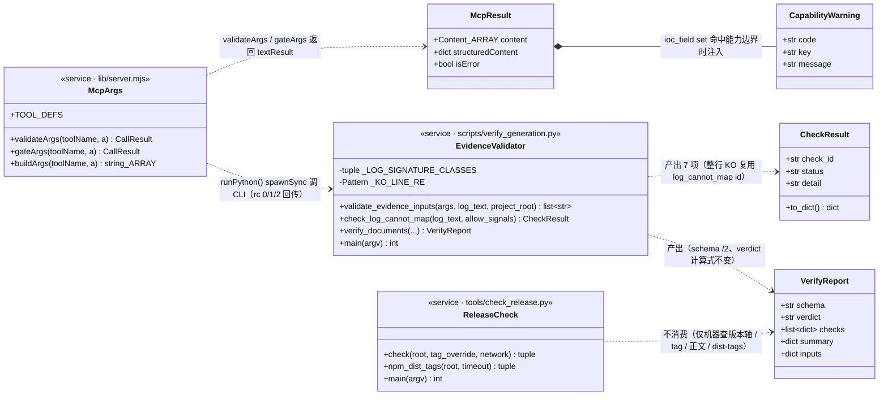
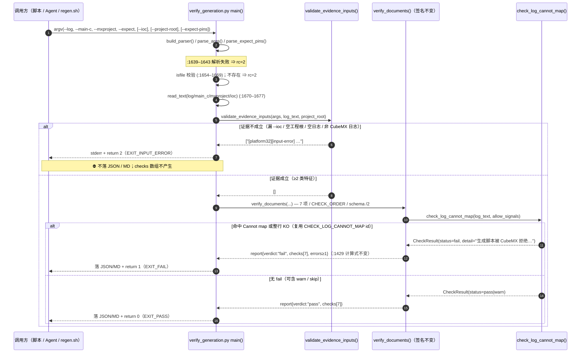
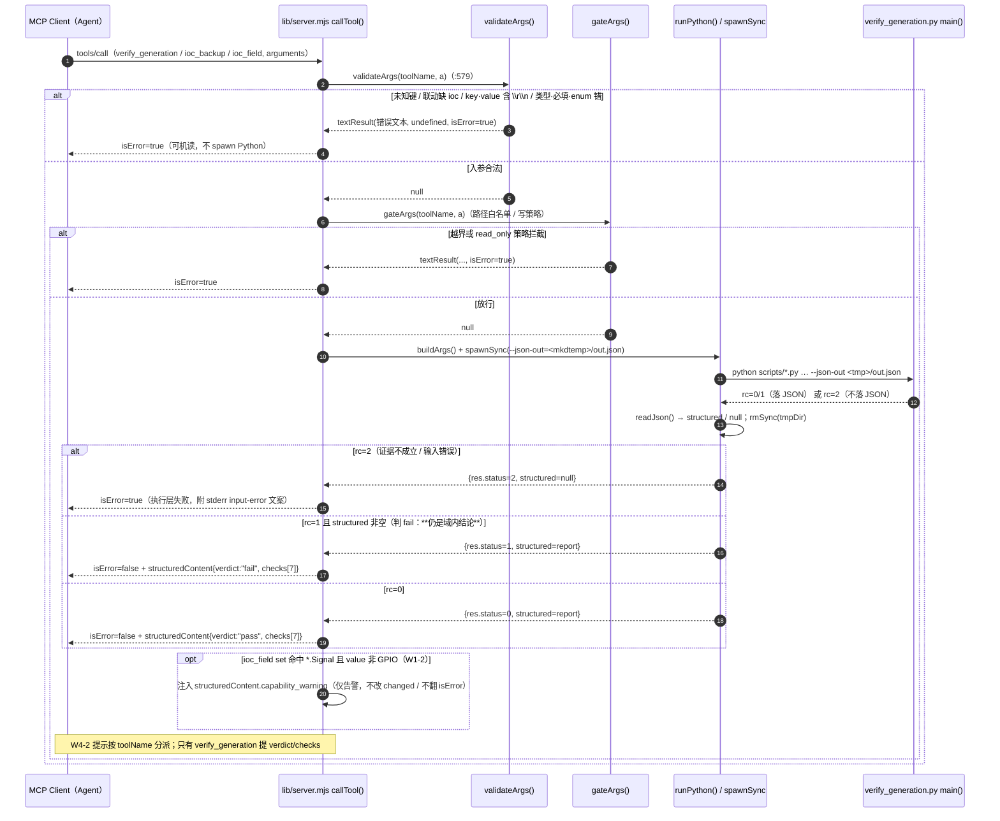
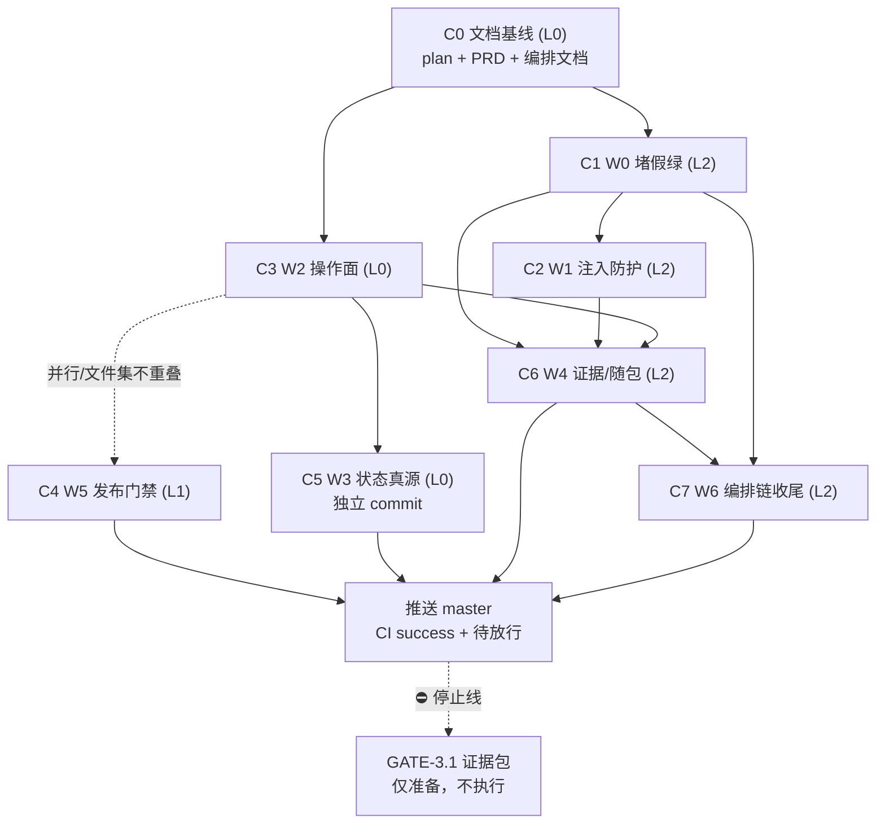

# cubeone-mcp W0–W6 审定整改 · 实现编排与任务分解（2026-11-04）

> **定位**：标准 SOP 第 2 阶段产出，供工程师逐 commit 执行。本文把工作区版
> `docs/2026-11-04-next-steps-plan.md`（W0–W6 任务卡、F-1~F-6、§5 用户裁决 D-1~D-5、§5.1 落地约束、
> §6 不做清单、§7 纪律、§8 勘察证据）与 `docs/reports/2026-11-04-w0w6-incremental-prd.md`
> 收敛成**精确到文件 / 函数 / 行号 / commit / 验收命令**的实现编排。
> **基线**：HEAD = `origin/master` = `683ee7f`（计划提交），工作区有主理人写入的**未提交修改**
> `M docs/2026-11-04-next-steps-plan.md`（+28/−9）与未跟踪的增量 PRD；`74589be` 是上一提交（审定报告定稿），
> 计划 §0 的 `74589be` 是时点快照，**当前 git 基线以 `683ee7f` 为准**。实现文件自 `74589be` 起未位移，
> 下文行号均已在**当前工作区实测复核**（与计划行号不一致处已按实测标注）。
> **本轮终点**：W0→W6 全批实现，停在 **GATE-3.1 之前**。⛔ 不打 tag / 不建 Release / 不 `npm publish` /
> 不回填发版台账；GATE-3.1 证据包**可以准备并列出、不得执行**。
> **本文不修改任何实现文件**，只新增本文档；Mermaid 图内嵌本文，不另落 `.mermaid` 文件，以免扩大 C0 文件集。

---

## 0. 执行摘要与用户裁决落实

| 裁决 / 问题 | 本编排的落地结论（不再重新讨论） |
|---|---|
| **D-1 / Q-1 版本轴** | **本轮四处保持 `0.7.2` 不动**（`package.json:3`、`SKILL.md:15` frontmatter、`README.md:302–303`）。W4-3「版本号同步」解释为「不引入 `version` 与 `tag` 不一致」，**升版属于发版批次、本轮不做**。`0.7.3` 仅为发版批次准备口径；发布正文须写 BREAKING behavior 与迁移提示。改 `SKILL.md` 时「加跑版本轴」= 校验四处同值 `0.7.2`，**不是升版**。 |
| **D-2 W3 隔离** | W3 是**单独一个 L0 commit（C5）**，文件集仅 `docs/TASKBOARD.md` + `docs/README.md` + `tools/check_taskboard.py`；**不得混入 `scripts/` 或 `lib/`**；改完**立刻**跑 `check_taskboard.py`；T2.2 / T2.6 / 串口 / `pio device monitor` **如实保留挂起**。 |
| **D-3 A-22** | `check_release.py` **保留脚本名与全部既有调用点**；补官方 registry、`--network` 下 dist-tags 判红、机器可查项；`docs/DECISIONS.md` **D35 内追加**「机器查 vs 人工核」清单，**不新增 D37**（否则 W3-3 的 D36 基准漂移）。 |
| **D-4 随包** | `package.json:25–36` `files` 补两本接板指南；同时 `SKILL.md` 顶部注明「`docs/` 仅仓库可见」；**两者都做**，`npm pack --dry-run` 可见。 |
| **D-5 停止线** | 逐批独立 commit、四条验收全绿、推送 `master` 确认 CI success 后向用户汇报待放行；**发版须用户另行明确放行**，不能因为 CI 绿了自动打 tag。 |
| **Q-2 宽松特征行** | 见 §3.2：5 类 OR 正则 + **命中不同类别 ≥ 2** 阈值，已对 7 个正向样本 / 5 个负向样本实测。 |
| **Q-3 `action` 口径** | **删「默认」二字、保持 required**（采纳计划倾向）。勘察结论：三个 schema 的 `required` 数组（`lib/server.mjs:230/253/276`）**没有 `default` 关键字**，「默认」只出现在 description 文字（`:250`「backup=备份(默认)」、`:274`「默认 false」）与 SKILL/README 措辞 ⇒ 按「**不改契约、只统一措辞**」处理：改 description 文案 + 文档同步，`required` / `enum` / `additionalProperties` / 运行时行为一律不动。 |
| **Q-4 B-2** | **本轮不做**，登记为「后续排期遗留项」（§5.3）。不新增任务卡、不扩张范围、不改 §6 不做清单。 |
| **Q-5 双会话 lost-update** | **本轮仅文档登记、不上文件锁**（最小方案，§5.4）；不新增实现任务、不改 §6。 |

### 0.1 三条刚性契约的落地要点（工程师逐条对照）

- **F-1「7 项判据 + schema `/2`」**：
  `scripts/verify_generation.py:96–113` 的 7 个 `CHECK_*` 与 `CHECK_ORDER`、`:88` `SCHEMA`、
  `:1429` `"verdict": "fail" if errors else "pass"`、`:1310–1321` `verify_documents()` 签名 **全部不动**。
  「证据不成立」在 **`main()` 输入校验层**统一退 `EXIT_INPUT_ERROR=2`；「整行 `KO`」在
  `check_log_cannot_map()` 内**复用 `CHECK_LOG_CANNOT_MAP` id** 判 `STATUS_FAIL`（rc=1）。
  `checks` 数组长度与 id 集合恒为 7。`ci.yml:268–269` 的 `--version | grep -q "/2"` 必须持续绿。
  ⚠️ **形态校验只能写在 `main()`，绝不能下移进 `verify_documents()`**——后者是纯函数，
  `tests/test_verify_multifile.py:127` 等用例直接调它并传合成 `LOG`（`:62` 起，只有
  `[INFO] CodeEngine:321 - Generated code…`，不含任何 CubeMX 特征类别），下移会大面积误伤，
  也违反「不改 `verify_documents()` 签名」的契约。
- **F-5 两条合法发布路径**：`publish.yml` 的 `workflow_dispatch` 是**正常发布入口**、
  `:87–101` 的 `::warning` 幂等跳过是 **D33 补发历史 Release** 的必然路径，**两者都保留**。
  发布门禁跑 `check_release.py` **不带 `--network`**；dist-tags 判红只加在 `--network`
  （发布后核证，显式 `--registry=https://registry.npmjs.org/`）；dispatch 增必填 `tag`
  并校验 `tag == package.json.version`；**不把 `check_release.py` 挂进 CI**（`ci.yml:257–261` 注释保留）。
  ⇒ 新增判据必须**分级**：不带 `--network` 时新项只进 `extras`（WARN），保证四条验收里的
  `python tools/check_release.py` 在「长期未发版 + 工作区有改动」状态仍 rc=0。
- **F-6 handshake SKIP**：`npm_mcp_handshake.mjs` 的 SKIP 是有意取舍（`:160`「宁可 SKIP 也不造假素材」）。
  A-24 **只把 `skip=N` 带进 headline 与 Job Summary**，**不翻 FAIL、不造假素材**；
  `:32–33` / `:128–133` 的 `--require-materials` 严格模式、`:378` `return fail === 0 ? 0 : 1`
  退出码 **一律不动**；`ci.yml:145` node 22 档仍用 `--ci`。

### 0.2 三条执行坑（F-2 / F-3）

1. `tests/test_verify_generation.py:586`（空日志 rc=0）与 `:766`（传 `--expect-pins` 没给 `--ioc` ⇒ skip）
   两条旧断言**必须改 / 拆**，变红是**预期**，不是回归。
2. 所有「必须不能 pass」的负样本**用 `run_cli()`（`:60–71`）直跑**，断言 `returncode` + stderr；
   **不复用 `run_verify()`**（`:74–108` 的 `:105 assert json_out.is_file()` 会掩盖 rc=2 —— 退 2 不落 JSON）。
3. W0-4 的形态校验会影响所有「以非日志文本当 `--log`」的既有用例，务必**全量**跑
   `python -m pytest tests/ -q` 逐条核对，不要只盯 F-2 那两条。已复核：
   `test_console_encoding.py:169`、`test_verify_generation.py:601/618` 都用不存在文件或 `LOG_CLEAN`，
   不受形态校验影响；既有 `log_*.txt` fixture 类别数 3~4（§3.2 实测表），不误伤。

---

# Part A · 系统设计

## 1. 实现方案与框架选型

**沿用现栈，无新增依赖包**：

| 层 | 现栈 | 本轮用法 |
|---|---|---|
| 判据 / 工具 | Python 3.11+ **纯标准库** | `argparse` / `re` / `glob` / `json` / `subprocess` / `pathlib`；新增 `validate_evidence_inputs()` 与 5 类正则常量，不引入任何第三方库 |
| MCP 封装 | Node.js **ESM**（`type: module`） | 仅改 `lib/server.mjs` 的 `validateArgs()` / `callTool()` / `runPython()` 诊断分支；`@modelcontextprotocol/sdk@1.32.2` 已入库，`npm ci` 可复现 |
| 编排链 | Bash（Git Bash） | `scripts/regen.sh` 的 `need_value()` / 退出码归一 / dry-run 分支；`shellcheck` 非阻塞 |
| CI / 发布 | GitHub Actions YAML | `ci.yml` lint 加轻量扫描；`publish.yml` 加门禁步骤；保持 dispatch + 幂等 `::warning` |
| 测试 | `pytest==9.2.0`、`pytest-cov==7.0.0`（CI 已钉版）、`node --test` | 只加用例，不改测试框架、不动 `--cov-fail-under=36` |
| 判据契约 | `references/verify-contract.md`（7 项 / schema `/2`） | **不改**，作为刚性真源 |

**架构模式**：CLI 与 MCP 是**两条通道、同一判据真源**。
CLI（`verify_generation.py main()`）是唯一判据执行体；MCP（`lib/server.mjs`）只做
「参数前置校验 → 路径白名单/写策略门禁 → `spawnSync` 调 CLI → 退出码→`isError` 映射 →
`structuredContent` 透传」。因此 **输入级校验双层落地**：CLI 侧 `validate_evidence_inputs()`（保真源），
MCP 侧 `validateArgs()`（提前给可机读错误、避免无谓 spawn）。
**核心难点与对策**：
- 「既要堵假绿、又不能新增第 8 个 check id」⇒ 把证据成立性放到 `main()` 输入层，域内失败复用 `log_cannot_map`。
- 「宽松形态判据不能制造新假红」⇒ OR 分类 + ≥2 类阈值，实测覆盖合成日志与 log4j 真实日志两种格式。
- 「发布门禁不能卡死正常发版」⇒ 新增判据按 `--network` 分级，本地路径保持 rc=0。
- 「并行改动互相覆盖」⇒ 文件集不重叠 + 单写者串行（§10）。

---

## 2. 文件清单（按 commit 分组，精确到函数 / 行号段 / 新增字段）

> 行号均为**当前工作区 `683ee7f` 实测值**。计划 §3 中 `:216–218/:240–245` 记的 `--dry-run mkdir -p`
> 实测在 `scripts/regen.sh:307`；计划 §3 记的 `:1705` 死路径回显实测在 `scripts/verify_generation.py:1704–1705`。
> 工程师以本表实测行号为准，按 `docs/README.md` §2「计划是时点快照、更正只追加勘误」处理。

### C0 · 文档基线（只提交，不改写内容）

| 文件 | 改动 |
|---|---|
| `docs/2026-11-04-next-steps-plan.md` | 直接提交工作区既有未提交修改（+28/−9）：状态行、§4(1) 版本措辞、§5 D-1~D-5 裁决、§5.1 落地约束。**不回改原文** |
| `docs/reports/2026-11-04-w0w6-incremental-prd.md` | 新增（当前未跟踪），278 行增量 PRD |
| `docs/reports/2026-11-04-w0w6-implementation-design.md` | 新增（本文） |

### C1 = W0 · 堵 G1 四类假绿（L2）

| 文件 | 改动点（函数 / 行号 / 新增字段） |
|---|---|
| `scripts/verify_generation.py` | ① `:149–165` 正则常量区新增 `_KO_LINE_RE = re.compile(r"^\s*KO\s*$")` 与 `_LOG_SIGNATURE_CLASSES`（5 类正则，§3.2）；② **新增** `validate_evidence_inputs(*, args, log_text, project_root) -> list[str]`（建议落在 `:1624` `main()` 之前）；③ `main()` `:1677` 读文本之后、`:1679` `verify_documents()` 之前插入调用，返回非空 ⇒ 逐行打印 `[platform32][input-error] …`（stderr）并 `return EXIT_INPUT_ERROR`；④ `check_log_cannot_map()` `:598–602` 循环追加 `elif _KO_LINE_RE.match(line): hits.append((lineno, line.strip()))`，命中即走 `:643–650` 的 `STATUS_FAIL`，detail 写「生成脚本被 CubeMX 拒绝（整行 KO）」，**复用 `CHECK_LOG_CANNOT_MAP` id**；⑤ `:604–609` 空日志 warn 分支**保留不改**（入口已退 2）；⑥ **不动** `:88 SCHEMA`、`:96–113` 7 个 `CHECK_*`/`CHECK_ORDER`、`:1310–1321` `verify_documents()` 签名、`:1429` verdict 式、`:1517–1581` `build_parser()` 参数名 |
| `lib/server.mjs` | `validateArgs()` `:421–474` 新增：① **未知键拒绝**（遍历 `Object.keys(a)` 对 `schema.properties`，落地 `additionalProperties:false`，错误文案列合法键名，§3.5）；② **`verify_generation` 的 `expect_pins`/`ioc` 联动**（§3.5）；**不改** `TOOL_DEFS:190–281` 的 required / enum / additionalProperties |
| `tests/fixtures/log_ko.txt` | **新增**：以 `log_clean.txt` 内容为底 + 末尾 2 行整行 `KO`，0 行 `Cannot map`。⚠️ 必须是「**真日志 + KO**」而非纯 `KO` 文本：形态成立（4 类）⇒ 走 rc=1 判 FAIL，不是 rc=2 |
| `tests/test_verify_generation.py` | ① `:586 test_empty_log_warns_not_passes` 改为 `run_cli()` 直跑，断言 rc=2 / stderr 含 `input-error` / 无 JSON；② `:766 test_pins_present_skips_without_flag_or_ioc` **拆两条**：无 flag 仍 `skip`（保留 `run_verify()`）；有 flag 无 ioc ⇒ `run_cli()` rc=2、无 JSON、stderr 点名 `--ioc`；③ 新增 W0-1/2/3/4 负样本（`run_cli()` 直跑）：漏 `--ioc`、`--project-root` 空目录、`Core/Src` 无 `.c`、`references/README.md`、随机文本、`log_ko.txt` ⇒ 不得 `verdict=PASS`；④ 新增 W0-4 正向回归：`log_clean.txt` + 标准 fixture ⇒ rc=0 / `verdict=PASS`，以及形态层对 7 个真实样本断言 `validate_evidence_inputs()` 返回 `[]` |
| `tests/test_verify_multifile.py` | 新增一条 **CLI** 负样本：`--project-root` 指向 `Core/Src/*.c` 为空的目录 ⇒ rc=2（配 `LOG_CLEAN` 当 `--log`）。⚠️ 本文件既有用例（`:127`）直调 `verify_documents(log_text=LOG)`，形态校验**不得**下移 |
| `tests/node/server.test.mjs` | 组 4（`:454 describe("组4 validateArgs 入口校验")`）增 1 条未知键拒绝（如 `projectRoot` ⇒ 提示应为 `project_root`）；并增 1 条 `expect_pins`/`ioc` 联动 |

### C2 = W1 · 堵 `.ioc` 内容注入 + 能力边界可机读（L2）

| 文件 | 改动点 |
|---|---|
| `scripts/ioc_field.py` | `get_value()`（`:120–144`）、`set_value()`（`:147–187`，注入点 `:177 lines[index] = f"{key}={value}{ending}"`）**入口**新增 `_reject_newlines(key, value)`：`\r`/`\n` 命中 ⇒ 抛 `ValueError`，`main()` 统一退 2，`.ioc` 行数不变、`changed=false`；`build_parser():190–213` 不动 |
| `lib/server.mjs` | ① `validateArgs()` 增 `key`/`value` 的 `/[\r\n]/` 拒绝（返回 `isError`，§3.5）；② `callTool():570–616` 在 `textResult(body, structured)` 前注入 `structuredContent.capability_warning`（§3.4，仅 `ioc_field set` 命中 `*.Signal` 非 GPIO 时）；**不改** `buildArgs():545–568` 的 `--` 位置参数语义 |
| `tests/test_ioc_field.py` | 新增 CRLF / LF / 尾空格三种变体 ⇒ `changed=false`、`.ioc` 行数不变、rc=2 |
| `tests/node/server.test.mjs` | 组 4 增 1 条换行注入拒绝；增 1 条 `capability_warning` 机读字段存在 + 文案可读断言 |

### C3 = W2 · 操作面归位（L0）

| 文件 | 改动点 |
|---|---|
| `SKILL.md` | ① `:43` §0.1 通道判据：`cubemx_help` / `pio_system_info` → 「`tools/list` 是否含本包 3 工具 / 注册后自检」；② `:127–134` §1.2 拆成「本包 3 工具（与 `TOOL_DEFS` 一一对应）」与「外部 server（另一通道、不属于本包）」两张表；③ 过期点 `:20, :96, :134, :327, :333–334, :353, :376–390, :413`：已达 L5 的（烧录 / 寄存器回读 / 目视 / LED）改「已实测（2026-11-04）」并指向 `docs/reports/phase2-bringup-2026-11-04.md`；**串口段与 `pio device monitor` 如实保留未实测**；GATE-2.1 安全确认保留、只去掉「无硬件」前提；§7 补 L5 报告；`D1–D30` → `D1–D36`；④ `:333–334` 换成仓内真实命令（`python -m pytest tests/ -q`），`:318/:360` 的 `AGENTS.md` 显式标注「模板仓，本仓不含」；⑤ `:230–231` 与 `:287` 统一回滚口径为「改前 `ioc_backup` → 失败从备份回滚」，**删掉 `git checkout --` 建议**；⑥ B-1 触发词收敛、返回噪声说明；B-6 两套入口参数面何时用哪个；⑦ **`:15` frontmatter version `0.7.2` 不动** |
| `README.md` | `:176` L5「本仓当前无硬件」→ 已实测口径；`:271`「4 个工具」→ 3 工具；其余过期点（含计划所列 `:287`）同步；**`:302–303` 版本轴 `0.7.2` 不动** |

### C4 = W5 · 发布门禁与防再漂移（L1）

| 文件 | 改动点 |
|---|---|
| `tools/check_release.py` | ① `npm_dist_tags():233–264` 的 `:245` 命令显式加 `--registry=https://registry.npmjs.org/`（**分开写并加引号**，见 `publish.yml:25–26` 的坑）；② `check():396–413`：`--network` 下 dist-tags 不一致从 `extras WARN` 改为 **`findings` FAIL**（发布后核证判红），网络失败仍只 WARN；③ 新增「台账回填 / Release 正文 / 工作区干净 / CI」机器可查项，**只在 `--network` 分支进 `findings`**，不带 `--network` 时进 `extras`（WARN）——保证四条验收 `rc=0`（F-5）；④ `main():418–432` 与模块 docstring `:25/:33`、`:432` help 文案同步（「失败只警告」→「dist-tags 不一致判红，仅发布后核证」）；⑤ **脚本名、所有既有调用点、`--tag`/`--repo-root` 参数不变** |
| `.github/workflows/publish.yml` | ① `:30–33` `on.workflow_dispatch` 增必填 `inputs.tag`（`required: true`），并用 `steps.pkg.outputs.version`（`:73–77`）校验 `tag == package.json.version`；`release` 事件校验 `github.event.release.tag_name`；② 「安装 pytest」之后、`:69` 升级 npm 之前新增门禁步骤：`python tools/check_taskboard.py` + `python tools/check_release.py`（**不带 `--network`**）+ tag 一致性；③ **保留 `workflow_dispatch`** 与 `:87–101` 幂等 `::warning` 跳过分支（D33 补发历史 Release） |
| `tools/npm_mcp_handshake.mjs` | ① `:374–377` headline 保持 `fail === 0` 判 PASS + `(pass= fail= skip=)` 三数并列（**已有 `skip=N`，不改语义、不翻 FAIL**）；② **新增** `--ci` 模式下写 `$GITHUB_STEP_SUMMARY`，列出 `pass/fail/skip` 与 `:372` 的 `skippedIds` 清单；③ **不动** `:32–33`、`:128–133` 严格模式、`:160` 「宁可 SKIP」、`:378` 退出码 |
| `.github/workflows/ci.yml` | ① `lint` job（`:192–316`）新增轻量状态词扫描：禁止 `SKILL.md`/`README.md` 出现「无硬件 / 整体挂起 / 未实测（无硬件）/ 一律缺」，并校验 `docs/README.md` 的 D 编号 == `docs/DECISIONS.md` 最大号（**D36**）；② **不把 `check_release.py` 挂进 CI**（保留 `:257–261` 注释）；③ `:145` node 22 档仍用 `--ci` |
| `docs/DECISIONS.md` | **D35（`:597–674`）内追加**一节「35.x 机器查 vs 人工核边界」：机器查（`check_release.py --network` 的版本轴/tag/正文/dist-tags/台账行/工作区）vs 人工核（CI success、GitHub Release 正文内容、npm 页面、用户放行）；并写明 `publish.yml` 门禁跑不带 `--network` 的理由（F-5）。**不新增 D37** |
| `docs/releases/README.md` | `:6` / `:45` 的「三证」措辞同步 F-5：发布前门禁跑不带 `--network`；`--network` 只用于发布后核证 dist-tags |

### C5 = W3 · 状态真源归位（**独立 commit / L0**，文件集**不含 `scripts/` 或 `lib/`**）

| 文件 | 改动点 |
|---|---|
| `docs/TASKBOARD.md` | ① `:46–49` 去掉「当前会话无硬件 / Phase 2 整体后移」；② `:116–121` 任务表按 R2 的 L5 事实重算（已达 L5 的按 `phase2-bringup-2026-11-04.md` 标注；**T2.2 FW_H7 / T2.6 负路径 / 串口 `pio device monitor` 如实保留挂起**——`:175` 明写本工程未启用任何 USART）；③ `:129` T3.3 阻塞说明；`:158` R2 行 L5；`:172–174` GATE-2.0/2.1/2.2；④ `:204` §4 快照表、`:208` 合计、**`:210–211` 散文 `35` → `36` 并改校验口径**；⑤ §5 `:237–268` 变更记录追加本批；⑥ **改完立刻跑 `check_taskboard.py` + 人工复核散文数字与表格一致**；**不得为了让脚本绿而把未实测项标成完成** |
| `docs/README.md` | ① `:14` / `:89` `D1–D35` → `D1–D36`；② `:57/:61` 去掉 v0.7.1「当前版本」标法（改指 0.7.2 为当前、0.7.1 为历史）；③ `:27` 计划索引行「未开工，待批准」→「**当前执行中**」；④ 补索引 `releases/2026-11-04-v0.7.2.md`、`reports/t0-redaction-audit.md`、`reports/2026-11-04-w0w6-incremental-prd.md`；⑤ 测试数字统一标注基准日期/命令；⑥ B-3 / A-26 的四套口径标注 |
| `tools/check_taskboard.py` | ① `:109 TAG_RE = ^v0\.[67]\.\d+` → `^v\d+\.\d+\.\d+`；② `publish_failures():520–552` 判据③改为「**当前版本 tag（`v<package.json.version>`）存在时 T3.5 不得待开始**」（当前 `:534` 是「任意 v0.6/v0.7 tag」全局代理），保留 git 不可用 / 无 tag 时 note 跳过；③ 模块 docstring `:27–29` 同步；④ 自测：构造含 `v0.8.0` 假 tag 的自测副本验证判据③仍生效，本仓 `rc=0` |

### C6 = W4 · 证据口径与随包可达性（L2）

| 文件 | 改动点 |
|---|---|
| `package.json` | `:25–36` `files` 增 `docs/guides/gate-2.0-checklist.md`、`docs/guides/testbeds-board-map.md`；**`:3` version `0.7.2` 不动**（Q-1） |
| `SKILL.md` | ① **顶部**（frontmatter `:1–15` 之后）新增「`docs/` 仅仓库可见；随包只有 `files` 清单内的两本接板指南 + `references/` + `SKILL.md`」声明，并逐个把 SKILL 引用的 7 个未随包 `docs/*.md` 标注「仅仓库可见」；② 第 5 步 `:351` 写清「**MCP 通道证据 = `structuredContent`，可另给 `report_md` 落盘，不产生 `verify.json`**」，`:93` 的 `--json-out … verify.json` 明确标注为 **CLI 通道**（两者不混淆）；③ W4-1 `tools/list` 描述同步（与 `lib/server.mjs` 一起）；④ Q-3：`action` 措辞删「默认」二字、保持 required（本仓相关段落同步）；⑤ **frontmatter version 不动** |
| `lib/server.mjs` | ① W4-1 `TOOL_DEFS:193–200` / `:264–265` 描述同步「MCP 不产生 verify.json / 证据是 `structuredContent`」；**不改 `runPython():297–332` 的 `mkdtempSync → rmSync` 机制**（stdout 纪律与安全模型依赖它）；② W4-2 `:611–614` 提示按 `toolName` 分派：仅 `verify_generation` 带「verdict / checks / summary.notes」提示，另两个工具不提；`:587–596` 去掉对死路径的引用；③ W4-4：`annotations:201` `readOnlyHint=true` 加注解澄清（`report_md`/`restore` 属证据输出、路径仍受白名单）；`:587–596` 按 `res.error.code` 分支（ETIMEDOUT / ENOENT / EACCES 各自处置文案）；`:319–327` `readJson()` 裸 catch 改为返回独立诊断字段（解析失败不再静默 `null`）；④ Q-3 description `:250` 删「(默认)」、`:274` 改「不传时等价于 false」——**`required` / `enum` / 行为零改动**；⑤ A-15 / A-16 的 `lib/server.mjs` 部分**留到 C7 串行改**（§10） |
| `scripts/verify_generation.py` | W4-2：`:1704–1705` 去掉 `--json-out` 的绝对路径回显（MCP 传入的是 `runPython()` 已 `rmSync` 的临时目录，必然失效）；**保留 `:1706–1707` `--report-md` 回显**（用户给的真实路径）。已复核 `tests/` 无断言该 stdout 文案，改动安全 |

### C7 = W6 · 编排链与 P2 收尾（L2）

| 文件 | 改动点 |
|---|---|
| `scripts/regen.sh` | ① W6-1 `:136–146` 11 处 `shift 2` 前判 `${2:-}` 为空即 `die 2`（或抽 `need_value()` helper）：`timeout 5 bash scripts/regen.sh -e` ⇒ 2 秒内退 2 且点名缺参；② W6-2 `:537 exit "$VERIFY_RC"` → 显式映射 `0/1` 透传、其余（9009 / 127 / 信号码）归一为 `2` 并打印原始码；③ W6-3 `:451` 超时分支「本次已从备份回滚」时序不实陈述修（实际 rollback 在 `:515`/`:325–347`，之前不得宣称已回滚）；④ W6-4 `:307 mkdir -p "$OUT_DIR"` 在 `DRY_RUN=1` 时跳过；`:403–408`/`:519–524` 的 KO 检查**不动**；B-8 头部 sandbox 注释与代码对齐；B-7 硬编码 CubeMX 路径可用 `ST_CUBEMX_*` 覆盖的说明 |
| `references/regen-exit-codes.md` | `:37–57` 退出码表补「其余码归一为 2」；`:42` 的「已从备份回滚」措辞对齐 W6-3 |
| `.gitignore` | `:38–41` 备份噪音段补 `*.ioc.bak.sha256`；`git check-ignore` 命中 sidecar |
| `tests/test_regen_preflight.py` | W6-1 加缺参退 2 用例（`:160` 已有 `test_ko_in_log_fails_generation_with_exit_1` 不受影响）；W6-3 用现成素材 `docs/logs/phase4/02-first-generate.log`、`04-first-generate-retry.log` 补 ≥4 条负样本（超时归因 / `--fail-fast-on-migrate` / 回滚 / 值变体含大小写与尾空格），**不造假素材** |
| `lib/server.mjs` | W6-4 的 A-15（`spawnSync():310–317` 同步阻塞 + 120 s 超时被误归因 → 补超时诊断文案与注释）、A-16（`physical():128–157` 全链解析失败时 fail-open 退回纯词法路径 → 改为显式拒绝/告警）；**与 W4-4 同一人串行改，避免并发覆盖** |
| （B-10 / Q-5） | B-10 杂项（散文口径、`.coverage` 陈旧标注、owner 冲突、历史 job 数标时间点）落在上述已有文件的注释/文档小修，**不新增文件**；Q-5 双会话 lost-update 竞态**仅在本编排文档 §5.4 登记**，本轮不上文件锁、不改实现 |

---

## 3. 接口与数据结构

### 3.1 `validate_evidence_inputs(...)` 签名、返回与落点

```python
# scripts/verify_generation.py —— 建议落在 main() (:1624) 之前，作为模块级函数
def validate_evidence_inputs(
    *,
    args: argparse.Namespace,
    log_text: str,
    project_root: str | None,
) -> list[str]:
    """校验「证据是否成立」。返回输入级错误文案列表；空列表 = 证据成立。

    ⚠️ 只在 main()（CLI 入口）调用，绝不进入 verify_documents()：
       · 保持 verify_documents() 签名/行为不变（F-1）；
       · 兼容直接调 verify_documents(log_text=...) 的既有用例
         （tests/test_verify_multifile.py:127 传的是合成 LOG，不含 CubeMX 特征）。
    """
```

`main()` 中的调用点（`:1677` 读文本之后、`:1679` `verify_documents()` 之前）：

```python
errors = validate_evidence_inputs(args=args, log_text=log_text, project_root=project_root)
if errors:
    for msg in errors:
        print(f"[platform32][input-error] {msg}", file=sys.stderr)
    return EXIT_INPUT_ERROR          # 2：不落 JSON / MD（写盘在 :1691 之后）
```

四条判据（全部返回文案，不抛异常、不改判据数组）：

| # | 条件 | 错误文案（要点） |
|---|---|---|
| W0-1 | `expect_pins` 非空且 `args.ioc` 为空 | `「--expect-pins 已给但未给 --ioc：引脚级检查无法进行；请同时提供两者，或都不给」`（**点名两个参数**） |
| W0-2 | `project_root is not None` 且 `glob(<root>/Core/Src/*.c)` 为空 | `「--project-root 指向的目录下 Core/Src/*.c 为空，工程根可能选错：<path>」`（空目录、`Core/Src` 存在但无 `.c` 都命中） |
| W0-4a | `not log_text.strip()` | `「--log 指向的文件为空，不是 CubeMX 生成日志：<path>」` |
| W0-4b | 命中特征类别数 `< 2`（§3.2） | `「--log 不像 CubeMX 生成日志（命中 N/5 类特征），拒绝当作生成证据：<path>；需要 CubeMX 原始 stdout 重定向文件」` |

**不判 `KO`**：整行 `KO` 是域内「生成确实失败」，形态成立时放行到 `check_log_cannot_map()` 判 `fail`（rc=1），
绝不在输入层退 2。四类假绿中前三类退 2，W0-3 判 fail。

### 3.2 Q-2 宽松特征行清单（正则 + 命中阈值 + 实测 + 如何测试）

**设计原则**：OR 语义、非严格模板。类别内部是「或」，类别之间**不要求全部命中、不要求顺序、
不要求固定行数、不要求固定前缀**；只统计**命中的不同类别数**。**不得**写成
「必须含某几行 / 必须 N 行 / 必须 `[INFO]` 开头」的严格模板，否则制造新的假红。

```python
# scripts/verify_generation.py —— 模块级常量（:149–165 正则区），re.IGNORECASE
_LOG_SIGNATURE_CLASSES: tuple[tuple[str, re.Pattern[str]], ...] = (
    ("C1 引擎启动",     re.compile(r"\[INFO\]\s*STM32CubeMX|Starting\s+STM32CubeMX|\bMicroXplorer\b", re.I)),
    ("C2 载入配置",     re.compile(r"\bLoadConfig\b|\bconfig\s+load\b", re.I)),
    ("C3 代码生成动作", re.compile(r"Generating code under|\bCodeGenerator\b|\bcode\s+generatio\b", re.I)),
    ("C4 生成完成",     re.compile(r"(?:Code|Project)\s+generation\s+finished|\bEnd\s+LoadConfig\(\)", re.I)),
    ("C5 运行时环境",   re.compile(r"\blog4j2?\b|AppUserModelID\s*:", re.I)),
)
MIN_SIGNATURE_CLASSES = 2
```

**为什么是这 5 类**（实测依据，两种日志格式都覆盖）：
- **合成精简日志**（`log_clean.txt`）：`[INFO] STM32CubeMX 6.18.1…`(C1) / `LoadConfig: loading`(C2) /
  `Generating code under`(C3) / `Code generation finished successfully` + `Project generation finished`(C4)。
- **真实 log4j 日志**（`docs/logs/phase4/`）：`[INFO] STM32CubeMX:60 - Starting STM32CubeMX` + `MicroXplorer`(C1) /
  `config load Project.ioc` + `Begin/End LoadConfig()`(C2) / `CodeGenerator:899 - code generatio: config db path`(C3) /
  `End LoadConfig()`(C4) / `log4j2.stm32cubemx.xml` + `AppUserModelID :`(C5)。
  ⚠️ 真实日志**没有** `Generating code under` / `Code generation finished`，所以不能只认合成日志的用词；
  `code generatio` 是 CubeMX 原始拼写（少了 `n`），正则按原样写。
- **禁止用裸词** `STM32CubeMX` / `CubeMX` / `config` / `code` 做唯一特征：`references/README.md:92/94`
  就含 `STM32CubeMX 6.18.1`、`CubeMX 6.18.1`，裸词会让它命中 ⇒ 假绿。上面的结构化模式
  （带 `[INFO]` 前缀 / `Starting` / `LoadConfig` / `config load` / `CodeGenerator` / `log4j`）README 一个都不含。

**命中阈值：`不同类别命中数 ≥ 2`**。等价实现：
`sum(1 for _, pat in _LOG_SIGNATURE_CLASSES if pat.search(log_text)) >= MIN_SIGNATURE_CLASSES`。
`≥2` 而非 `≥1` 的价值：单行伪造 `[INFO] STM32CubeMX 6.18.1` 只命中 1 类，被挡住；
拿 `.ioc`（首行 `#MicroXplorer Configuration settings…`，命中 C1 共 1 类）当 `--log` 也被挡住。

**实测（2026-11-04，当前工作区，Python `re.I`，脚本见交付消息）**：

| 样本 | 类别命中数 | 结论 |
|---|---|---|
| `tests/fixtures/log_clean.txt` | **4**（C1/C2/C3/C4） | 正向，放行 |
| `docs/logs/phase4/02-first-generate.log` | **3**（C1/C2/C5） | 正向，放行（首次生成/迁移探测日志，C3/C4 缺失仍 ≥2） |
| `04-first-generate-retry.log` | **5** | 正向，放行 |
| `07-regen/cubemx-generate.log` | **5** | 正向，放行 |
| `08-regen-SET.log` | **5** | 正向，放行 |
| `09-final/cubemx-generate.log` | **5** | 正向，放行 |
| `12-askformigrate-probe.log` | **5** | 正向，放行 |
| `references/README.md` | **0** | 挡住（rc=2） |
| 空文件 / 随机文本 | **0** | 挡住（rc=2） |
| 单行伪造 `[INFO] STM32CubeMX 6.18.1` | **1** | 挡住（rc=2，`≥2` 的价值） |
| `log_clean.txt` + 2 行整行 `KO` | **4**，KO 命中 2 | 形态成立 ⇒ `check_log_cannot_map()` 判 fail（rc=1），**不退 2** |

**既有 fixture 不误伤复核**：`log_cannot_map_missing_s_prefix.txt`=4、`log_syscalls_overlay.txt`=3、
`log_vp_rif_cannot_map.txt`=3、`log_clean.txt`=4 ⇒ `test_verify_generation.py` 现有用例全部放行。
`mxproject_abs_path.txt` / `mxproject_relative.txt`=0、`ioc_g474_template.txt`=1 是 `.mxproject`/`.ioc` 输入，
不是 `--log`，不受影响（误传也会被 `≥2` 挡住）。

**正向回归样本清单（明确限定）**：只认 **CubeMX 原始 stdout 重定向日志**
（`02-first-generate.log` / `04-first-generate-retry.log` / `07-regen/cubemx-generate.log` /
`08-regen-SET.log` / `09-final/cubemx-generate.log` / `12-askformigrate-probe.log` / `log_clean.txt`）。
⚠️ `docs/logs/phase4/*-stdout.log`（`07-regen-stdout.log`、`09-final-stdout.log`）是 **`regen.sh` 编排输出**，
实测类别数 **0**，**不是** `--log` 的合法输入，不要拿来当正向样本。

**如何测试**（W0-4 验收落地，分两层）：
1. **形态层单测**（新增 `test_validate_evidence_inputs_*`）：直接断言 `validate_evidence_inputs()`
   对上表 7 个正向样本返回 `[]`；对 `references/README.md` / 空 / 随机文本 / 单行伪造返回非空。
2. **CLI 层负样本**（`run_cli()` 直跑，F-3）：`references/README.md`、`tmp_path/empty.log`、
   `tmp_path/random.log` ⇒ 断言 `returncode == 2`、stderr 含 `[platform32][input-error]`、
   **无 JSON 落盘**；`log_ko.txt` ⇒ 断言 `returncode == 1`、`report["verdict"] == "fail"`、
   `check_of(report, CHECK_LOG_CANNOT_MAP)["status"] == "fail"`、`len(report["checks"]) == 7`。
3. **端到端正向**：`log_clean.txt` + `tests/fixtures/main_g474_template.c` +
   `tests/fixtures/mxproject_relative.txt` + `--expect GPIO` ⇒ `rc=0` / `verdict=PASS`。
   phase4 真实日志因缺少配套同工程 `main.c`/`.mxproject`，只断言「**不退 2 / stderr 无 `input-error`**」，
   不强求 `verdict=PASS`（避免制造假红）。
4. 改 `:586` 断言为 rc=2（F-2），拆 `:766`（F-2），全量 `pytest tests/ -q` 复核。

### 3.3 退出码 `{0,1,2}` 约定与 MCP 映射

| rc | 常量 | 触发 | JSON / MD 落盘 | stderr 前缀 | MCP `isError` |
|---|---|---|---|---|---|
| `0` | `EXIT_PASS` | 7 项 checks 无 `fail`（可含 warn/skip） | ✅ | — | `false` + `structuredContent{verdict:"pass"}` |
| `1` | `EXIT_FAIL` | `verdict=="fail"`：`Cannot map` 或**整行 `KO`** 命中 `log_cannot_map`，或其它 check fail | ✅（**域内结论必须落盘**） | — | `false` + `structuredContent{verdict:"fail"}` |
| `2` | `EXIT_INPUT_ERROR` | 输入/IO/参数错误、**证据不成立**（W0-1/2/4）、`parse_expect_pins` 失败 | ❌（**不落盘**） | `[platform32][input-error]` / `[ioc_field][input-error]` | `true`（执行层失败，`isExecFailure():346–361` 白名单制） |

关键交互：`rc=2` 不落 JSON ⇒ `runPython()` 的 `structured=null` ⇒ `isExecFailure()` 判 `true` ⇒
`isError=true`；`rc=1` + structured 非空 ⇒ 域内结论 ⇒ `isError=false`。**这是 F-3 与 MCP 层一致性的根据**，
工程师不得在 `isExecFailure()` 里给 rc=2 开例外。

### 3.4 `structuredContent.capability_warning` 字段（W1-2）

由 `lib/server.mjs` 的 `callTool()` 在 `textResult(body, structured)` **之前**注入
（**不改 `scripts/ioc_field.py` 的输出结构**，保持 CLI 契约纯净）：

```js
// 仅当 structured 非空时注入；不设 isError、不改 changed、不拦截写入
// （能力层 ≠ 权限层，见 references/capability-boundary.md:8–10）
if (
  toolName === "ioc_field" && a.action === "set" &&
  /\.Signal\s*$/i.test(String(a.key)) &&          // key 形如 PA9.Signal
  !/^GPIO/i.test(String(a.value ?? "")) &&          // value 非 GPIO_*（如 USART1_TX）
  structured !== null
) {
  structured = {
    ...structured,
    capability_warning: {
      code: "OUT_OF_TOOL_CAPABILITY",
      key: String(a.key),
      message:
        "写入 " + a.key + " 超出本工具能力边界（仅可靠处理 GPIO / Mcu.IP* 键值）；" +
        "须手改 .ioc 或走 CubeMX GUI 后强制过 G1 核验（SKILL.md §0.0）。",
    },
  };
}
```

验收：机读字段存在且文案可读即可；**不做权限层拦截**（`set PA9.Signal USART1_TX` 仍可执行、
`changed` 语义不变）。`tests/node/server.test.mjs` 组 4 增断言。

### 3.5 `validateArgs` 未知键与联动规则的错误文本格式

统一前缀 `[cubeone-mcp][参数错误]`，返回 `textResult(lines.join("\n"), undefined, true)`
（`isError=true`、无 `structuredContent`、不 spawn Python）：

| 规则 | 错误文本（格式） |
|---|---|
| 未知键（W0-5，`additionalProperties:false` 落地） | `[cubeone-mcp][参数错误] 未知参数：projectRoot；合法参数：log / main_c / mxproject / expect / project_root / ioc / expect_pins / allow_signal / report_md（见 tools/list 的 inputSchema）` —— 多个未知键用 `、` 连接；合法键取 `Object.keys(props)`；对常见 camelCase 追加 `⇒ 是否想写 project_root？` 提示 |
| 联动（W0-1，`verify_generation`） | `[cubeone-mcp][参数错误] expect_pins 与 ioc 必须同时提供：给了 expect_pins 但缺 ioc，引脚级检查无法进行（否则核验器会退 2）` |
| 换行注入（W1-1，`ioc_field`） | `[cubeone-mcp][参数错误] key 含换行符（\r / \n），拒绝写入：避免 .ioc 内容注入`（`value` 同理） |

CLI 侧对应文案（`ioc_field.py`）：`[ioc_field][input-error] key/value 含换行符，拒绝写入` ⇒ rc=2。
两层文案**点名同一组参数**，便于排障。

### 3.6 数据结构与接口关系（classDiagram）



---

## 4. 程序调用流程（Mermaid 时序图）

### 4.1 CLI 通道：从 argv 到 verdict / rc



### 4.2 MCP 通道：从 tools/call 到 structuredContent / isError



---

## 5. 主理人裁决 Q-1~Q-5 的集中落地说明

### 5.1 Q-1 版本轴（防误改 `package.json`）

**本轮四处保持 `0.7.2` 同值，一个字符都不改**：`package.json:3` / `SKILL.md:15` frontmatter /
`README.md:302`「仓库发布标签」/ `README.md:303`「SKILL.md 的 version」。
W4-3 的「版本号同步」= **不引入 `version` 与 `tag` 不一致**；`npm pack --dry-run` 只用于看两本指南，
不触发升版。改 `SKILL.md` 时加跑的「版本轴校验」是**一致性检查**：

```bash
node -p "require('./package.json').version"          # 期望 0.7.2
grep -nE '0\.7\.2' SKILL.md README.md                # 四处仍同值
python tools/check_release.py                        # 不带 --network，rc=0（四处 + tag v0.7.2 一致）
```

⛔ 任何 commit 都不允许出现 `0.7.3` 的版本轴改写；`0.7.3` 只允许出现在「发版批次准备」的说明文字中。

### 5.2 Q-3 `action` 口径

勘察结论：schema 里**没有 `default` 关键字**，只有 `required`（`lib/server.mjs:230/253/276`）与
`enum`（`:247–251`、`:271`）。「默认」只存在于 description 文字：`:250`「backup=备份(**默认**)」、
`:274`「true=只计算不写盘（**默认 false**）」，以及 SKILL/README 的措辞。
⇒ 按「**不改契约、只统一措辞**」处理：
- `lib/server.mjs:250` 删「(默认)」；`:274` 改为「不传时等价于 false」（准确描述行为，不宣称 default）。
- `SKILL.md` / `README.md` 中写「action 默认 backup」的段落同步改为「action 为 required，须显式给」。
- **`required` / `enum` / `additionalProperties` / `validateArgs()` 的必填判定 / `buildArgs()` 行为零改动**。
- `tests/node/server.test.mjs` 组 4 既有 5 例不得受影响（W4-4 验收判据）。

### 5.3 Q-4 B-2 —— 本轮不做（后续排期遗留项）

审定报告 P2 **B-2**（无 `outputSchema`；`structuredContent` 无体积上限；长 stdout 会截掉首行 `verdict`）
在计划 §2 覆盖编号与 §3 任务卡中**无承接**。本轮：
- **不新增任务卡 / 不扩张范围 / 不改 §6 明确不做清单**；
- 登记为「后续排期遗留项」，建议下一轮单独评估：`outputSchema` 契约、`structuredContent` 体积上限、
  `lib/server.mjs:291–294 tail(s, n=12000)` 保留首行 `verdict` 的截断策略（当前策略是「只保留末 12000 字符」，
  与 `verify_generation.py` 的 `render_console()` 首行 verdict 冲突）。
- 与本轮的关系：W4-2 只去死路径回显 + 提示分派，**不触碰 `tail()` 与 `outputSchema`**。

### 5.4 Q-5 双会话 lost-update 竞态 —— 仅文档登记（不上文件锁）

W6-4 提到「双会话同时跑 `regen.sh` / `ioc_field set` 可能互相覆盖备份与 `.ioc`」。
**本轮最小方案：仅文档登记，不上文件锁**，理由：
- 上锁需新增 sidecar 锁文件、超时/僵死锁回收、跨进程一致性测试，属范围扩张；
- 本仓 SOP 已有单写者纪律（`docs/README.md` §7、`CONTRIBUTING.md`）与 `ioc_backup.py` 的
  SHA-256 完整性校验，能**检测**部分覆盖但不能**阻止**；
- 现有 CI 与四条验收不覆盖并发场景，贸然加锁会引入新的假红来源。

登记内容（本文即登记处）：**已知限制**——同一工程目录上并发执行两个会话时，
`ioc-backup.json` / `*.ioc.bak` / `.ioc` 可能 lost-update；**规避**——遵守单写者原则，
不同时用两个会话改同一工程；**后续排期**——若确需并发，评估 `flock`/锁文件 + 锁超时 + 负样本。
⛔ 本轮不改实现、不加锁、不新增任务卡、不改 §6。

---

# Part B · 任务分解

## 6. Required Packages（无新增第三方包）

```
（本轮新增：无）
—— 现栈，全部已入库 / 已钉版，不改版本号 ——
Python 3.11+ 标准库：argparse / re / glob / json / subprocess / pathlib / os / sys
Node.js ESM：@modelcontextprotocol/sdk@1.32.2（package.json:45–47 已有，package-lock.json 已入库）
Bash：Git Bash（coreutils：timeout / grep / sed）
GitHub Actions：actions/checkout@v5 / setup-node@v5 / setup-python@v6（已有）
测试：pytest==9.2.0、pytest-cov==7.0.0（ci.yml:63 / :219 已钉版，本轮不动）
```

`npm ci --no-audit --no-fund` 复现依赖树；`scripts/` 全部纯标准库，**不装任何 pip 包也能跑**。

## 7. ★ 有序任务列表 / 逐批独立 commit（C0 → C7）

> 执行序：`C0 → C1(W0) → C2(W1) → [C3(W2) ∥ C4(W5)] → C5(W3) → C6(W4) → C7(W6)`。
> C3 与 C4 **文件集完全不重叠，可并行开发**；提交序列建议 `C3 → C4`（W5-4 的状态词扫描断言
> SKILL/README 已清理，C3 先提交则 C4 的 lint 直接绿）。**C5(W3) 必须在 C3 之后**（W2 先定口径）。
> W0/W1 ≥ L2、W3 = L0、其余按性质 L0~L2；每条 message 带 L 等级声明。
> 「四条固定验收」= `python -m pytest tests/ -q` / `node --test tests/node/*.test.mjs` /
> `python tools/check_taskboard.py` / `python tools/check_release.py`，**每个 commit 后必跑、须全绿**。

### C0 — 文档基线

| 项 | 内容 |
|---|---|
| **message** | `docs(plan): 记录 D1-D5 用户裁决与增量 PRD（L0）` |
| **文件集合** | `docs/2026-11-04-next-steps-plan.md`（工作区 M）、`docs/reports/2026-11-04-w0w6-incremental-prd.md`（新增）、`docs/reports/2026-11-04-w0w6-implementation-design.md`（本文，新增） |
| **依赖** | 无（第一个 commit） |
| **验收** | 四条固定验收（确认基线绿）+ 版本轴四处 `0.7.2` 同值；`git status --short` 提交后应为空 |

### C1 — W0 堵 G1 四类假绿（**L2**）

| 项 | 内容 |
|---|---|
| **message** | `fix(verify): 堵住 G1 四类假绿，证据不成立统一退 2（L2）` |
| **文件集合** | `scripts/verify_generation.py`、`lib/server.mjs`、`tests/fixtures/log_ko.txt`（新）、`tests/test_verify_generation.py`、`tests/test_verify_multifile.py`、`tests/node/server.test.mjs` |
| **依赖** | C0 |
| **验收** | 四条固定验收 **+** `python scripts/verify_generation.py --version \| grep -q "/2"`（7 项 / schema 不变）<br>`python -m pytest tests/test_verify_generation.py tests/test_verify_multifile.py -q`（含 `:586` / `:766` 改拆后的用例）<br>负样本用 `run_cli()`：漏 `--ioc` / 空目录 / `Core/Src` 无 `.c` / `references/README.md` / 空日志 / 随机文本 ⇒ rc=2 且无 JSON；`log_ko.txt` ⇒ rc=1 + `verdict=FAIL` 且 `len(checks)==7`<br>正向：`log_clean.txt` + 标准 fixture ⇒ rc=0 / PASS；7 个真实日志 ⇒ 不退 2 |

### C2 — W1 堵 `.ioc` 注入 + 能力边界机读（**L2**）

| 项 | 内容 |
|---|---|
| **message** | `fix(ioc): 双层拒绝换行注入并补能力边界机读字段（L2）` |
| **文件集合** | `scripts/ioc_field.py`、`lib/server.mjs`、`tests/test_ioc_field.py`、`tests/node/server.test.mjs` |
| **依赖** | C1（同改 `lib/server.mjs` / tests，单写者串行） |
| **验收** | 四条固定验收 **+** `pytest tests/test_ioc_field.py -q`（CRLF/LF/尾空格 ⇒ `changed=false`、行数不变、rc=2）<br>`node --test tests/node/server.test.mjs`（组 4 换行拒绝 + `capability_warning` 断言）<br>人工确认：`set PA9.Signal USART1_TX` **未被拦截**（能力层 ≠ 权限层），仅 `structuredContent.capability_warning` 可读 |

### C3 — W2 操作面归位（**L0**）

| 项 | 内容 |
|---|---|
| **message** | `docs(skill): 操作面归位——工具面/通道判据/L5 现状/回滚口径（L0）` |
| **文件集合** | `SKILL.md`、`README.md` |
| **依赖** | C0（与 C4 并行、文件集不重叠） |
| **验收** | 四条固定验收 **+ 版本轴四处 `0.7.2` 同值**<br>`grep -n cubemx_help SKILL.md`（不再充当通道判据）；SKILL 工具表与 `TOOL_DEFS` 一一对应<br>全文检索「无硬件 / 整体挂起 / 一律缺」在 SKILL/README 归零；串口段与 `pio device monitor` 仍标未实测<br>全文只剩一种回滚口径（无 `git checkout --` 建议）；SKILL 反引号路径仓内不存在的引用归零（占位符显式标注） |

### C4 — W5 发布门禁与防再漂移（**L1**）

| 项 | 内容 |
|---|---|
| **message** | `ci(release): 补齐发布门禁与状态词扫描，保留 dispatch 与幂等补发路径（L1）` |
| **文件集合** | `tools/check_release.py`、`tools/npm_mcp_handshake.mjs`、`.github/workflows/publish.yml`、`.github/workflows/ci.yml`、`docs/DECISIONS.md`（D35 内追加）、`docs/releases/README.md` |
| **依赖** | C3（建议，状态词已清理）；与 C3 无文件重叠，可并行开发 |
| **验收** | 四条固定验收（**注意 `check_release.py` 不带 `--network` 仍须 rc=0**）<br>`python tools/check_release.py --network`（对当前 `v0.7.2` ⇒ rc=0）；构造错版本副本（`--tag v9.9.9` 或临时改 package.json 副本）⇒ rc≠0<br>`node tools/npm_mcp_handshake.mjs --ci`（输出可见 `skip=N`，`--require-materials` 行为与退出码不变）<br>注入一个失效状态词到 SKILL ⇒ lint 扫描判红；当前 HEAD 绿；`grep -n "check_release.py" .github/workflows/ci.yml` 仍只是注释<br>`grep -n workflow_dispatch .github/workflows/publish.yml` 仍在；`::warning` 幂等分支仍在；D 编号最大仍为 **D36** |

### C5 — W3 状态真源归位（**独立 commit / L0**）

| 项 | 内容 |
|---|---|
| **message** | `docs(board): 状态真源归位——按 R2 L5 重算看板/快照/索引（L0）` |
| **文件集合** | `docs/TASKBOARD.md`、`docs/README.md`、`tools/check_taskboard.py`（**仅这三个 + W3 项；⛔ 不得混入 `scripts/` 或 `lib/`**） |
| **依赖** | C3（W2 先定口径）；与 C4 无文件重叠 |
| **验收** | **改完立刻** `python tools/check_taskboard.py`（rc=0）+ 人工复核散文数字与表格一致<br>四条固定验收<br>构造含 `v0.8.0` 假 tag 的自测副本 ⇒ 判据③仍生效；本仓 rc=0<br>`grep -n '^### D' docs/DECISIONS.md` 最大号 = **D36**；`docs/README.md` 的 D 编号 = D36<br>`git diff --stat` 确认无 `scripts/` / `lib/` 文件；T2.2 / T2.6 / 串口 / `pio device monitor` 仍为挂起 |

### C6 — W4 证据口径与随包可达性（**L2**）

| 项 | 内容 |
|---|---|
| **message** | `fix(mcp): 证据口径、随包可达性与返回文本分派（L2）` |
| **文件集合** | `SKILL.md`、`README.md`（Q-3 措辞同步）、`lib/server.mjs`、`package.json`、`scripts/verify_generation.py`（W4-2 去死路径回显） |
| **依赖** | C1、C2（同改 `lib/server.mjs`，单写者串行）；C3（SKILL/README 已改过，串行不冲突） |
| **验收** | 四条固定验收 **+ 版本轴四处 `0.7.2` 同值**（`package.json` version **未改**）<br>`npm pack --dry-run` 清单**必须能看到** `docs/guides/gate-2.0-checklist.md` 与 `docs/guides/testbeds-board-map.md`<br>SKILL 顶部「`docs/` 仅仓库可见」声明存在、无随包死链；不出现「MCP 会生成 verify.json」<br>`node --test tests/node/server.test.mjs`（组 1 增 ETIMEDOUT 用例、组 4 既有 5 例不受影响）<br>`grep -n 默认 lib/server.mjs`（Q-3 措辞统一，`required` 未动） |

### C7 — W6 编排链与 P2 收尾（**L2**）

| 项 | 内容 |
|---|---|
| **message** | `fix(regen): 退出码归一、缺参不死循环、dry-run 不写盘与 P2 收尾（L2）` |
| **文件集合** | `scripts/regen.sh`、`references/regen-exit-codes.md`、`.gitignore`、`tests/test_regen_preflight.py`、`lib/server.mjs`（A-15/A-16，与 W4-4 同人串行） |
| **依赖** | C1（脚本单写者链）、C6（`lib/server.mjs` 串行） |
| **验收** | 四条固定验收 **+** `timeout 5 bash scripts/regen.sh -e`（2 秒内退 2 且点名缺参）<br>假 Python 桩造 9009 ⇒ 退 2（打印原始码）；`pytest tests/test_regen_preflight.py -q` 全绿<br>`git check-ignore -v path/to/Project.ioc.bak.sha256` 命中；`--dry-run` 不建目录（对比 `OUT_DIR` 不存在）<br>超时文案不再宣称「已从备份回滚」；`bash -n scripts/regen.sh` 通过 |

### 7.1 任务分组（≤5 个任务，供工程师排班；与上表 commit 一一对应）

| 任务 ID | 任务名 | 对应 commit | 文件数 | 依赖 | 优先级 |
|---|---|---|---|---|---|
| T01 | 项目基础设施：文档基线 + 配置/入口/依赖声明（本轮为文档基线，配置与依赖零改动） | C0 | 3 | — | P0 |
| T02 | 核心判据与 MCP 参数层（真假绿 + 注入防护 + 测试） | C1、C2 | 8 | T01 | P0 |
| T03 | 操作面与状态真源（SKILL/README/TASKBOARD/校验脚本） | C3、C5 | 4 | T01（C5 额外依赖 C3） | P0 |
| T04 | 发布门禁与 CI 防漂移（workflow / tools / D35 / 台账） | C4 | 6 | T03 | P1 |
| T05 | 证据口径、随包可达性与编排链收尾（W4/W6） | C6、C7 | 8 | T02、T03 | P1 |

> 每个任务 ≥3 个相关文件；配置文件（若有）全部集中在 T01；任务之间尽量只依赖 T01/T02，
> 无长线性链。上表**不替代** §7 的逐 commit 序列——工程师**按 C0→C7 逐个提交**。

## 8. Shared Knowledge（跨切关注点，工程师必读）

1. **版本轴**：本轮四处保持 `0.7.2` 不动；`0.7.3` 仅发版批次准备口径。⛔ 不改 `package.json:3`。
2. **刚性契约**：7 个 `CHECK_*` + `CHECK_ORDER` + `SCHEMA="platform32.verify_generation/2"` 恒定；
   「证据不成立」在 `main()` 输入校验退 `2`（不落 JSON）；整行 `KO` **复用 `log_cannot_map`** 判 `fail`（rc=1）；
   **不得**新增第 8 个 check id、改 `:1429` verdict 式、动 `verify_documents()` 签名。
3. **形态校验落点**：只能在 `main()`，**绝不能进 `verify_documents()`**（会破坏直调用例与签名契约）。
4. **退出码**：`0` pass / `1` fail（域内结论，**仍落 JSON/MD**）/ `2` 输入错误（**不落盘**，
   stderr `[platform32][input-error]` / `[ioc_field][input-error]`）。MCP：`rc=2 ⇒ isError=true`；
   `rc=1 + structured ⇒ isError=false`。
5. **负样本**：一律 `run_cli()` 直跑（`run_verify()` 的 `:105` 断言会掩盖 rc=2）；正向用例继续用 helper。
6. **发布流**：`workflow_dispatch` 是正常入口；`::warning` 幂等分支合法（D33 补发）；门禁跑
   `check_release.py` **不带 `--network`**；dist-tags 判红只在 `--network` 发布后核证
   （`--registry=https://registry.npmjs.org/`）；**`check_release.py` 不挂 CI**。
7. **CI 与 handshake**：`ci.yml` node 22 档仍用 `--ci`；SKIP 不翻 FAIL、不造假素材；
   `--require-materials` 行为与退出码不变。
8. **决策编号**：`docs/DECISIONS.md` 最大号恒为 **D36**；本轮**不新增 D37**（W5-1 只在 D35 内追加
   「机器查 vs 人工核」一节）。`docs/README.md` 的 D1–D36 与 `SKILL.md:413` 的 D1–D36 以此为基准。
9. **随包清单**：`npm pack --dry-run` 必须含两本接板指南；SKILL 顶部「`docs/` 仅仓库可见」与 `files`
   **互为补充，不能只做其一**。
10. **未实测能力**：T2.2 FW_H7、T2.6 负路径、串口 / `pio device monitor` 一律如实保留挂起；
    不得为让 `check_taskboard.py` 变绿而标完成（`phase2-bringup-2026-11-04.md:175` 明写未启用 USART）。
11. **Q-3 `action`**：schema 无 `default`，只统一 description 措辞，契约零改动。
12. **遗留登记**：Q-4 B-2（后续排期）、Q-5 双会话 lost-update（仅文档登记、不上锁）——
    本轮不新增任务卡、不改 §6 明确不做清单。
13. **文档纪律**：`docs/README.md` §2「计划是时点快照、不回改，更正只追加勘误」；
    三份旧计划原文不动；本文与旧计划/PRD 冲突时以**工作区版计划 §3 / §5.1 / §6** 为准。
14. **提交纪律**：Conventional Commits + L 等级；每批独立 commit；每批四条固定验收全绿；
    改 `SKILL.md` 加跑版本轴一致性；W3 改完立刻跑 `check_taskboard.py`。
15. **停止线**：不打 tag / 不建 Release / 不 `npm publish` / 不回填发版台账；GATE-3.1 证据包可准备、不可执行。

## 9. Task Dependency Graph



## 10. 单写者边界与并行冲突规避

| 写者 | 独占文件集 | 串行顺序 |
|---|---|---|
| **写者 A（脚本 / MCP 单写者）** | `scripts/**`（`verify_generation.py`、`ioc_field.py`、`regen.sh`）、`lib/server.mjs` | **C1(W0) → C2(W1) → C6(W4-4 + A-15/A-16 的 lib 部分留给 C7) → C7(W6-4 的 lib/server.mjs)** 全程同一人、一次一文件，**不得两人同时改 `lib/server.mjs`** |
| **写者 B（操作面 / 文档）** | `SKILL.md`、`README.md`、`docs/**`、`references/**`、`package.json` | C3 → C5 → C6 的 SKILL/README 部分（串行，不与写者 A 的 `lib/server.mjs` 重叠） |
| **写者 C（发布 / CI）** | `.github/workflows/*`、`tools/check_release.py`、`tools/npm_mcp_handshake.mjs`、`docs/DECISIONS.md`、`docs/releases/README.md` | C4 |
| **tests/** | 跟随对应实现 | C1/C2/C6/C7 各自带上对应测试文件；`tests/node/server.test.mjs` 被 C1、C2、C6 依次改（同一人串行、按 commit 顺序） |

**W2 ∥ W5 并行不冲突的根据**：C3 只改 `SKILL.md` + `README.md`；C4 只改
`tools/check_release.py` / `tools/npm_mcp_handshake.mjs` / `.github/workflows/{ci,publish}.yml` /
`docs/DECISIONS.md` / `docs/releases/README.md` —— **零文件重叠**。
唯一软依赖是 W5-4 的 lint 扫描断言 SKILL/README 已清理失效状态词，故**提交顺序取 C3 → C4**；
若确实并行开发，C4 的验收须等 C3 落盘后再跑 lint。
**W3 隔离**：C5 文件集只有 `docs/TASKBOARD.md`、`docs/README.md`、`tools/check_taskboard.py`，
⛔ 不混入 `scripts/` 或 `lib/`，与 C4 的 `tools/check_release.py` 也互不重叠。
**W6-4 的 A-15/A-16**：`lib/server.mjs` 与 W4-4 由同一写者按 C6 → C7 顺序串行改，无并发覆盖风险。

## 11. 37 条需求池 → W0–W6 / commit 映射核对表

> 合计 **37 条：P0 10 / P1 17 / P2 10**（与审定报告 §6、PRD §3 一一对应）。
> 「随包」= 改动落在 `SKILL.md` / `lib/` / `scripts/` / `package.json`。**B-2 单列「本轮不做/遗留」。**

| # | 编号 | 承接任务卡 | commit | 随包 | 核对 |
|---|---|---|---|---|---|
| 1 | A-1 | W2-1 | C3 | 是 | ✓ |
| 2 | A-5 | W2-2 + W3-1 | C3 + C5 | 是(W2)/否(W3) | ✓ |
| 3 | A-7 | W4-1 | C6 | 是 | ✓ |
| 4 | A-11 | W0-1 | C1 | 是 | ✓ |
| 5 | A-14 | W0-2 | C1 | 是 | ✓ |
| 6 | A-17 | W0-3 + W0-4 | C1 | 是 | ✓ |
| 7 | A-21（含 A-20） | W1-1 + W1-2 | C2 | 是 | ✓ |
| 8 | A-22 | W5-1 | C4 | 否 | ✓ |
| 9 | A-23 | W5-2 | C4 | 否 | ✓ |
| 10 | A-24 | W5-3 | C4 | 否 | ✓ |
| 11 | A-2 | W4-4 | C6 | 是 | ✓ |
| 12 | A-3 | W4-3 | C6 | 是 | ✓ |
| 13 | A-4 | W0-4 | C1 | 是 | ✓ |
| 14 | A-6 | W5-4 | C4 | 否（CI） | ✓ |
| 15 | A-8（3 子项） | W0-5(②) + W4-4(余项) | C1 + C6 | 是 | ✓ |
| 16 | A-9 | W4-2 | C6 | 是 | ✓ |
| 17 | A-10 | W2-3 | C3 | 是 | ✓ |
| 18 | A-12 | W2-4 | C3 | 是 | ✓ |
| 19 | A-13 | W3-3 | C5 | 否 | ✓ |
| 20 | A-15 | W6-4（与 W4-4 同批改 `lib/server.mjs`） | C7 | 是 | ✓ |
| 21 | A-16 | W6-4（同上） | C7 | 是 | ✓ |
| 22 | A-18 | W6-1 | C7 | 是 | ✓ |
| 23 | A-19 | W6-2 | C7 | 是 | ✓ |
| 24 | A-25 | W6-3 | C7 | 部分 | ✓ |
| 25 | A-26 | W3-3 | C5 | 部分 | ✓ |
| 26 | A-27 | W3-2 | C5 | 否 | ✓ |
| 27 | A-28 | W3-1 | C5 | 否 | ✓ |
| 28 | B-1 | W2 | C3 | 是 | ✓ |
| 29 | **B-2** | **无承接任务卡** | **—** | 是 | **本轮不做 / 后续排期遗留（Q-4，§5.3）** |
| 30 | B-3 | W3-3 | C5 | 否 | ✓ |
| 31 | B-4 | W6-4 | C7 | 部分 | ✓ |
| 32 | B-5 | W6-4 | C7 | 否 | ✓ |
| 33 | B-6 | W2 | C3 | 否 | ✓ |
| 34 | B-7 | W6-4 | C7 | 部分 | ✓ |
| 35 | B-8 | W6-4 | C7 | 部分 | ✓ |
| 36 | B-9 | W6-4 | C7 | 部分 | ✓ |
| 37 | B-10 | W6-4 | C7 | 否 | ✓ |

**核对结论**：36 条有明确承接任务卡与 commit，**B-2 单列遗留**；无遗漏、无重复编号、
无新增任务卡、未扩张 §6 明确不做清单。P0 10 / P1 17 / P2 10 = 37 计数一致。

## 12. 推送预案（D-5 / 计划 §7）

**前提**：C0→C7 全部落盘、每个 commit 后四条固定验收全绿、工作区干净
（`git status --short` 为空；C0 已把 plan 的未提交修改与 PRD 一并提交）。

**主路径（先试）**：计划 §7 的 HTTP 代理（本机 WorkBuddy 注入的 `HTTPS_PROXY=127.0.0.1:45843`
对 GitHub 返回 502，必须显式换端口）：

```bash
export PATH="/c/Users/Leon/.workbuddy/binaries/PortableGit/versions/1.2.0/usr/bin:/c/Users/Leon/.workbuddy/binaries/PortableGit/versions/1.2.0/bin:$PATH"
cd "D:/Projects/GitHub/cubeone-mcp"
HTTPS_PROXY=http://127.0.0.1:7897 https_proxy=http://127.0.0.1:7897 \
HTTP_PROXY=http://127.0.0.1:7897 http_proxy=http://127.0.0.1:7897 \
git -c http.sslBackend=openssl push origin master
```

**备用路径（502 / 超时 / SSL 失败即切换）**：本机另一条已验证路径为 SSH 映射
`github.com → ssh.github.com:443`（`~/.ssh/config` 已有），专用 key `~/.ssh/github_cubeone_ci`
已注册账号。**不改 `origin` 的 fetch URL**，用一次性 URL 推送：

```bash
# ~/.ssh/config 已有 Host github.com → HostName ssh.github.com / Port 443 / IdentityFile ~/.ssh/github_cubeone_ci
git push git@github.com:LeonhardtHUST/cubeone-mcp.git master
# 若需显式指定 key / config：
git -c core.sshCommand="ssh -i ~/.ssh/github_cubeone_ci -F ~/.ssh/config" \
    push git@github.com:LeonhardtHUST/cubeone-mcp.git master
```

**推完确认（两条都要）**：

```bash
git fetch origin
git log origin/master..HEAD            # 必须为空（本地与远端同点）
gh run list --workflow CI --branch master --limit 1   # 或在 Actions 页面确认 CI success（7 job 全绿）
```

- `git log origin/master..HEAD` 清空 + CI success ⇒ 向用户汇报**待放行**，本轮工作结束。
- 若 CI 红 ⇒ 定位失败 job、修复后**新增一个修复 commit**（不改写已推送历史、不 `--amend` / `push --force`），
  重跑四条验收再推。
- ⛔ **不得**因为 CI 绿了就自动打 tag / 建 Release / `npm publish` / 回填台账。

## 13. 停止线与 GATE-3.1 证据包（仅准备、不得执行）

**本轮终点**：C0→C7 全批实现、逐批独立 commit、四条验收全绿、推送 `master` 并确认 CI success。
⛔ **不得执行**：打 tag（`v0.7.3`）、创建 GitHub Release、`npm publish`、发布台账回填。

**GATE-3.1 证据包（可以准备并列出，不得执行）**：
1. `python tools/check_release.py --network` 判绿（发布后核证，带官方 registry）；
2. `python tools/check_taskboard.py` rc=0；
3. `python -m pytest tests/ -q` 全绿；
4. `node --test tests/node/*.test.mjs` 全绿；
5. CI success（7 job 全绿）；
6. 发布正文三条 CLI 命令与 `argparse` 逐一对得上，且写明 **BREAKING behavior** 与迁移提示
   （原本拿 `verdict=PASS` 的四类输入现退 2 或判 FAIL；`ioc_field set` 拒绝换行；MCP 未知参数被拒）；
7. **用户明确放行**。

W3 / W5 是仓库内改动（CI、工作流、文档），随时可推送、不必等版本（计划 §4(5)）。

## 14. Anything UNCLEAR / 待明确事项

| # | 事项 | 本编排的处理 | 是否需主理人再裁决 |
|---|---|---|---|
| 1 | 计划 §0 基线写 `74589be`、当前 HEAD 是 `683ee7f` | 已实测：`683ee7f` 是「计划提交」、`74589be` 上一提交；实现文件未位移，本文行号按当前工作区实测复核并标注差异（`regen.sh:307`、`verify_generation.py:1704–1705`）。按 `docs/README.md` §2「时点快照、不回改」处理 | 否（事实核对，已闭合） |
| 2 | W0-4 第四个负样本「含 `KO` 真日志」的语义 | 明确为「**真日志 + 整行 KO**」（`log_ko.txt`），形态成立 ⇒ 走 rc=1 判 FAIL，**不是** rc=2；前三个样本（README / 空 / 随机）才退 2。已实测（§3.2） | 否（已给出可执行口径） |
| 3 | W4-2 的 `verify_generation.py:1705` 落在哪个 commit | 落在 **C6(W4)**，因此 C6 文件集含 `scripts/verify_generation.py`；W3 的「不得混入 scripts/」限制**只约束 C5**，不受影响 | 否 |
| 4 | `docs/DECISIONS.md` D35 追加是否算「新增决策」 | 只在 D35 内追加 35.x 节，**不新增 D37**，保证 W3-3 的 D36 基准不漂移 | 否 |
| 5 | `check_release.py` 新增「工作区干净 / CI」判据会不会让四条验收变红 | 已分级：新增项只在 `--network` 进 `findings`，不带 `--network` 进 `extras`(WARN)；保证 `python tools/check_release.py` 在长期未发版状态 rc=0（F-5） | 否 |
| 6 | C3 与 C4 并行的提交顺序 | 建议 C3 → C4（W5-4 lint 断言 SKILL 已清理）；文件集零重叠，可并行开发 | 否 |
| 7 | Q-4 B-2 / Q-5 lost-update | 分别登记为「后续排期遗留」与「仅文档登记、不上锁」，本轮不做、不新增任务卡、不改 §6 | 否（按主理人裁决执行） |
| 8 | `npm view` 的 `--registry` 参数写法 | 按 `publish.yml:25–26` 的坑「`--registry=<url>` 连写在部分 npm shim 上会被拆参」⇒ **分开写并加引号** | 否 |

**结论：无阻断性待明确事项**，可交付工程师执行。若实现中发现计划未覆盖的新歧义，
由架构师在实现编排中给出明确方案并回传主理人，**不得自行扩张范围或改动 §6 明确不做清单**（§5.1(6)）。

---

> 本文是 `683ee7f` 时点的**实现编排**，不是新计划；与计划冲突时以工作区版
> `docs/2026-11-04-next-steps-plan.md` §3 / §5.1 / §6 原文为准。后续若实现发生位移，
> 按 `docs/README.md` §2 约定**追加勘误链接**，不回改本文与旧计划原文。
